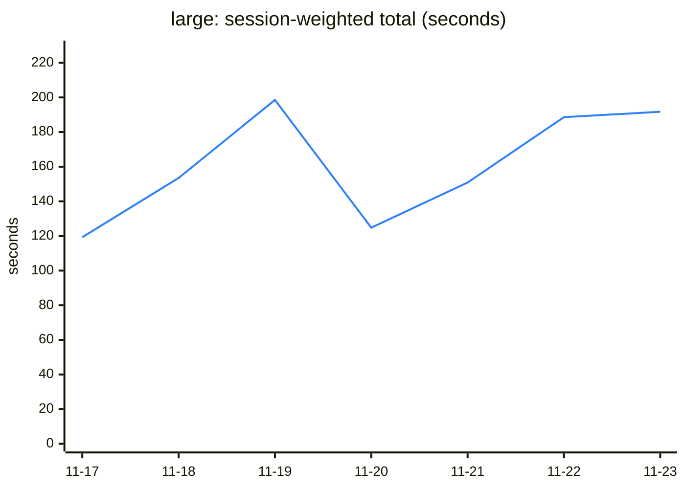
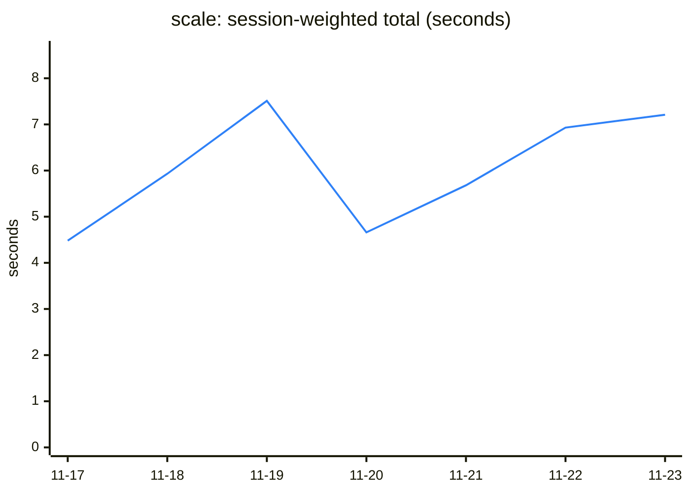
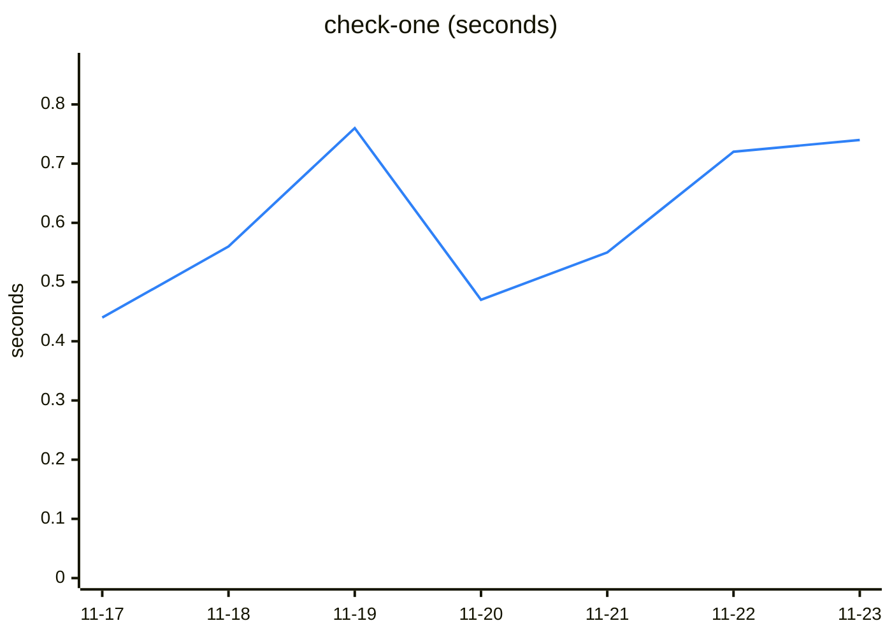
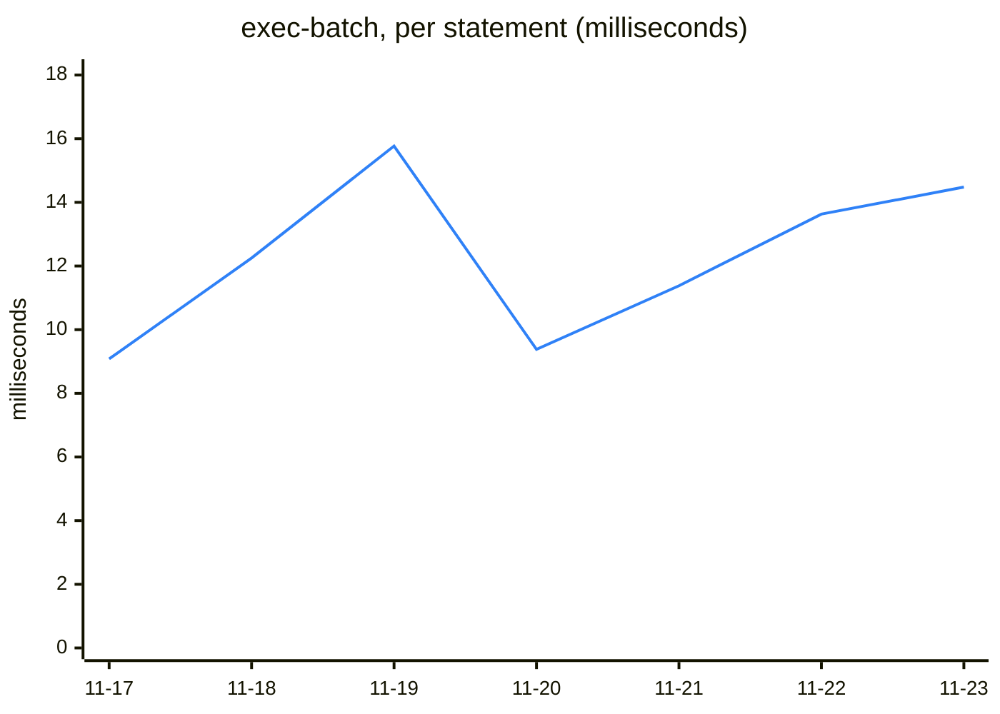
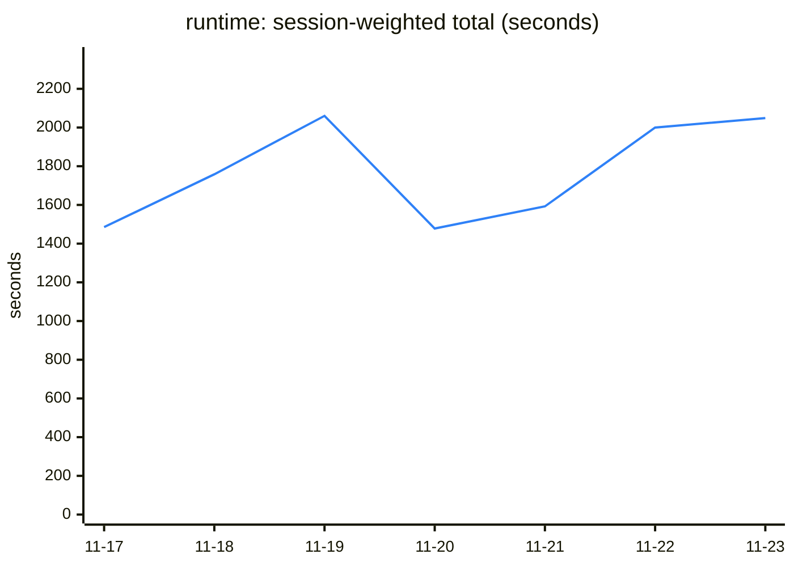

# Agent dev-loop benchmark — trend

7 runs, 2026-11-17 to 2026-11-23. Latest: `mxcli version 4fe3aa9 (2026-11-23T10:13:44Z)` against `mxcli version nightly-20261117-4fe3aa983 (2026-11-17T10:58:18Z)`.

Generated by `scripts/agentbench/trend` after each run; do not edit. Times are the candidate's median wall time on that night's runner, so two nights differ by the machine as well as by the code: read a level that stays, not one night's step. How to read it: `docs-site/src/internals/agent-benchmark.md` on `main`.

## Alerts

None.

## small project — 370 units

| step | latest | run before | median of the 7 before | against that median | against its baseline, latest | last runs |
|---|---:|---:|---:|---:|---:|---|
| (session-weighted total) | 127.9 s | 125.6 s | 101.7 s | × 1.26 | × 0.98 | ▁▄█▁▃▇█ |
| open-cold | 188 ms | 190 ms | 191 ms | × 0.98 | × 1.01 | ▁█▇▁█▇▇ |
| open | 67 ms | 67 ms | 57 ms | × 1.19 | × 1.00 | ▁▅█▁▅██ |
| domain | 851 ms | 837 ms | 681 ms | × 1.25 | × 1.00 | ▁▄█▁▂▇█ |
| microflows | 615 ms | 607 ms | 519 ms | × 1.19 | × 1.00 | ▁▅█▁▄██ |
| pages | 1.97 s | 1.96 s | 1.66 s | × 1.19 | × 0.99 | ▁▆█▁▄██ |
| describe | 158 ms | 153 ms | 123 ms | × 1.29 | × 1.00 | ▁▄█▁▃▇█ |
| catalog | 286 ms | 279 ms | 219 ms | × 1.31 | × 0.99 | ▁▄█▁▄██ |
| catalog-full | 1.43 s | 1.41 s | 1.11 s | × 1.29 | × 0.99 | ▁▄█▁▃██ |
| query | 96 ms | 97 ms | 79 ms | × 1.21 | × 1.00 | ▁▅█▁▄██ |
| check | 409 ms | 400 ms | 325 ms | × 1.26 | × 1.00 | ▁▄█▁▃▇█ |
| single-edit | 424 ms | 418 ms | 335 ms | × 1.27 | × 0.99 | ▁▄█▁▃▇█ |
| catalog-after-edit | 268 ms | 265 ms | 221 ms | × 1.21 | × 0.98 | ▁▅█▁▅██ |
| bulk-alter | 1.39 s | 1.38 s | 1.18 s | × 1.18 | × 0.99 | ▁▅█▁▄▇█ |
| re-exec | 715 ms | 699 ms | 585 ms | × 1.22 | × 1.00 | ▁▅█▁▃██ |
| rename | 618 ms | 607 ms | 493 ms | × 1.25 | × 0.99 | ▁▄█▁▃██ |

## large project — 910 units

| step | latest | run before | median of the 7 before | against that median | against its baseline, latest | last runs |
|---|---:|---:|---:|---:|---:|---|
| (session-weighted total) | 191.7 s | 188.6 s | 152.2 s | × 1.26 | × 1.00 | ▁▄█▁▄▇█ |
| open-cold | 357 ms | 353 ms | 346 ms | × 1.03 | × 1.00 | ▁██▁▆▇▇ |
| open | 88 ms | 83 ms | 70 ms | × 1.26 | × 1.01 | ▁▅█▁▄▇█ |
| domain | 1.01 s | 984 ms | 808 ms | × 1.25 | × 1.01 | ▁▄█▁▃▇█ |
| microflows | 1.58 s | 1.53 s | 1.15 s | × 1.37 | × 0.99 | ▁▃█▁▄▇█ |
| pages | 2.44 s | 2.39 s | 2.13 s | × 1.15 | × 0.99 | ▁▅█▁▆▇█ |
| describe | 187 ms | 185 ms | 147 ms | × 1.27 | × 0.98 | ▁▃█▁▃▇▇ |
| catalog | 429 ms | 426 ms | 329 ms | × 1.30 | × 1.00 | ▁▄█▁▄██ |
| catalog-full | 4.52 s | 4.43 s | 3.48 s | × 1.30 | × 1.00 | ▁▄█▁▂██ |
| query | 100 ms | 105 ms | 83 ms | × 1.20 | × 0.96 | ▁▅█▁▄██ |
| check | 654 ms | 641 ms | 507 ms | × 1.29 | × 1.01 | ▁▄█▁▃██ |
| single-edit | 631 ms | 622 ms | 505 ms | × 1.25 | × 0.98 | ▁▄█▁▄██ |
| catalog-after-edit | 383 ms | 375 ms | 332 ms | × 1.15 | × 1.01 | ▁▆█▁▅▇█ |
| bulk-alter | 1.71 s | 1.68 s | 1.42 s | × 1.20 | × 1.00 | ▁▅█▁▄▇▇ |
| re-exec | 997 ms | 987 ms | 796 ms | × 1.25 | × 1.01 | ▁▄█▁▃▇█ |
| rename | 1.26 s | 1.24 s | 976 ms | × 1.29 | × 1.00 | ▁▄█▁▃██ |

## scale project — 4374 units

| step | latest | run before | median of the 7 before | against that median | against its baseline, latest | last runs |
|---|---:|---:|---:|---:|---:|---|
| (session-weighted total) | 7.21 s | 6.93 s | 5.81 s | × 1.24 | × 1.00 | ▁▄█▁▄▇█ |
| check-cold | 1.99 s | 1.90 s | 1.68 s | × 1.19 | × 0.99 | ▁▅█▁▅▇█ |
| check-one | 745 ms | 716 ms | 555 ms | × 1.34 | × 1.01 | ▁▃█▁▃▇█ |
| check-batch | 1.33 s | 1.28 s | 1.01 s | × 1.32 | × 1.00 | ▁▃█▁▃▇█ |
| exec-batch | 1.45 s | 1.36 s | 1.18 s | × 1.23 | × 1.01 | ▁▄█▁▃▆▇ |
| re-exec-batch | 757 ms | 741 ms | 599 ms | × 1.26 | × 0.99 | ▁▄█▁▃▇█ |
| new-batch | 948 ms | 931 ms | 785 ms | × 1.21 | × 1.00 | ▁▅█▁▄▇█ |

## running app — 476 units

| step | latest | run before | median of the 7 before | against that median | against its baseline, latest | last runs |
|---|---:|---:|---:|---:|---:|---|
| (session-weighted total) | 2048.7 s | 1999.9 s | 1675.4 s | × 1.22 | × 1.01 | ▁▄█▁▂██ |
| mx-check | 8.57 s | 8.19 s | 6.33 s | × 1.35 | × 1.02 | ▁▄▇▁▂██ |
| build | 58.4 s | 56.9 s | 51.6 s | × 1.13 | × 0.99 | ▁▆█▁▅██ |
| boot | 29.9 s | 30.4 s | 24.8 s | × 1.20 | × 1.03 | ▂▅█▁▃██ |
| page-check | 3.28 s | 3.23 s | 2.88 s | × 1.14 | × 0.97 | ▃▆█▁▃██ |
| hot-apply | 5.52 s | 5.50 s | 4.90 s | × 1.12 | × 1.00 | ▁▄█▁▂▆▆ |
| test-attach | 139 ms | 138 ms | 109 ms | × 1.28 | × 0.97 | ▁▃█▁▄██ |
| apply-entity | 18.7 s | 18.2 s | 16.1 s | × 1.16 | × 1.00 | ▁▄█▁▃▇█ |
| stop | 842 ms | 842 ms | 734 ms | × 1.15 | × 1.00 | ▁▆█▃▆██ |
| test-cold | 26.5 s | 25.0 s | 20.8 s | × 1.27 | × 1.08 | ▁▄█▁▁▇█ |
