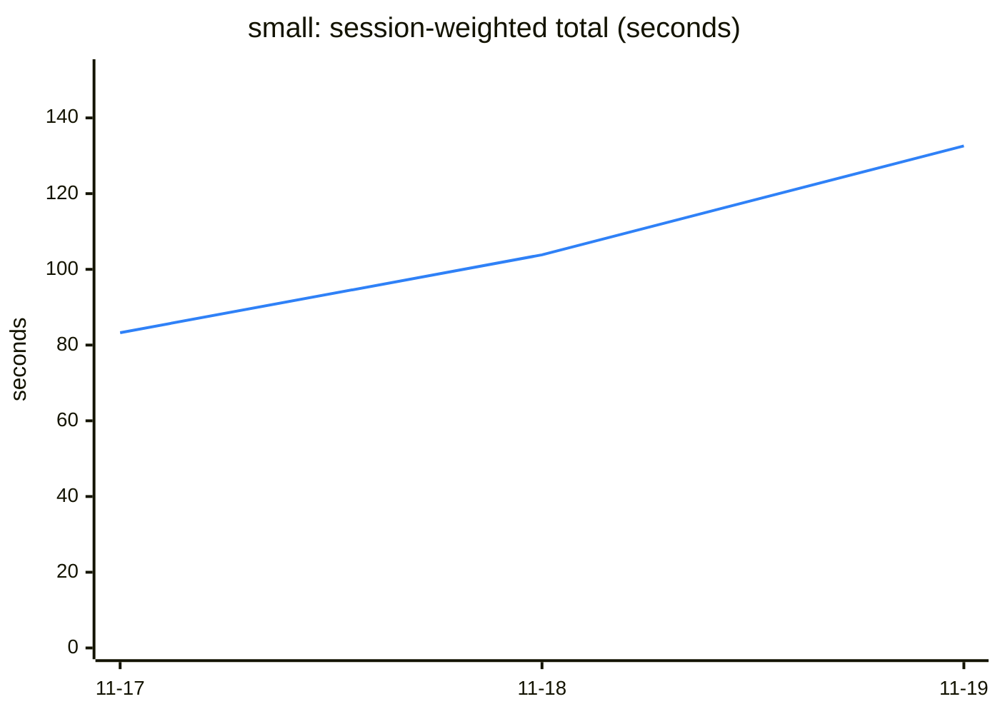
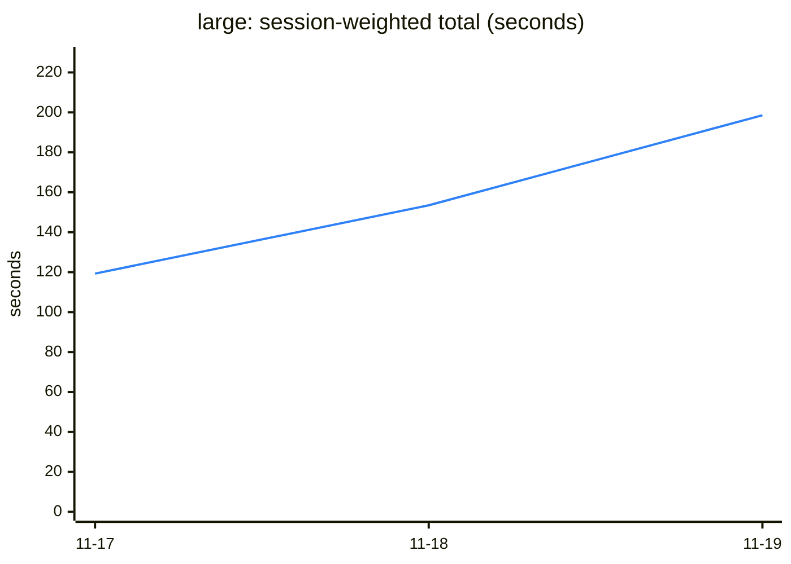
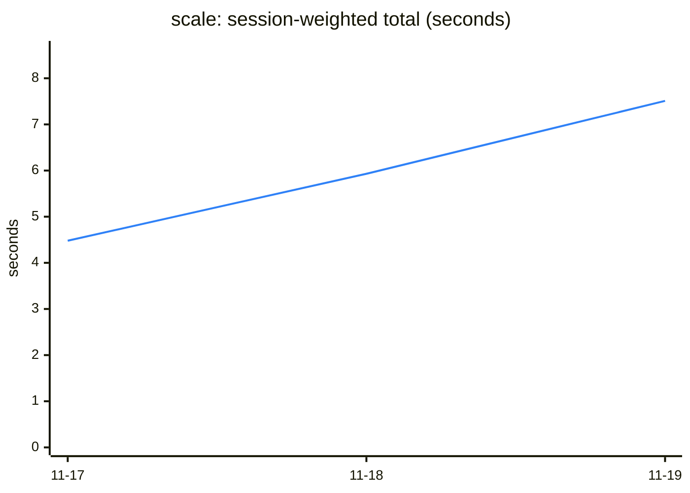
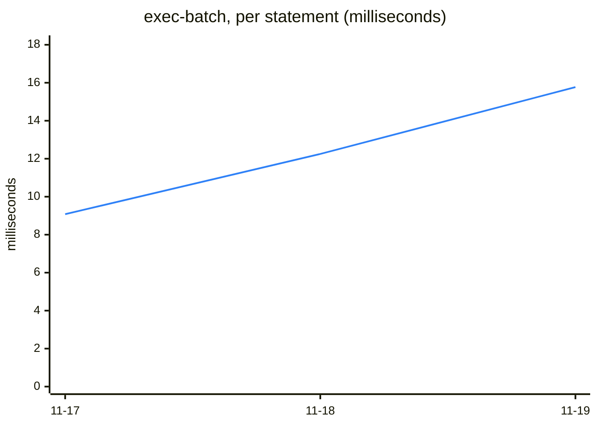
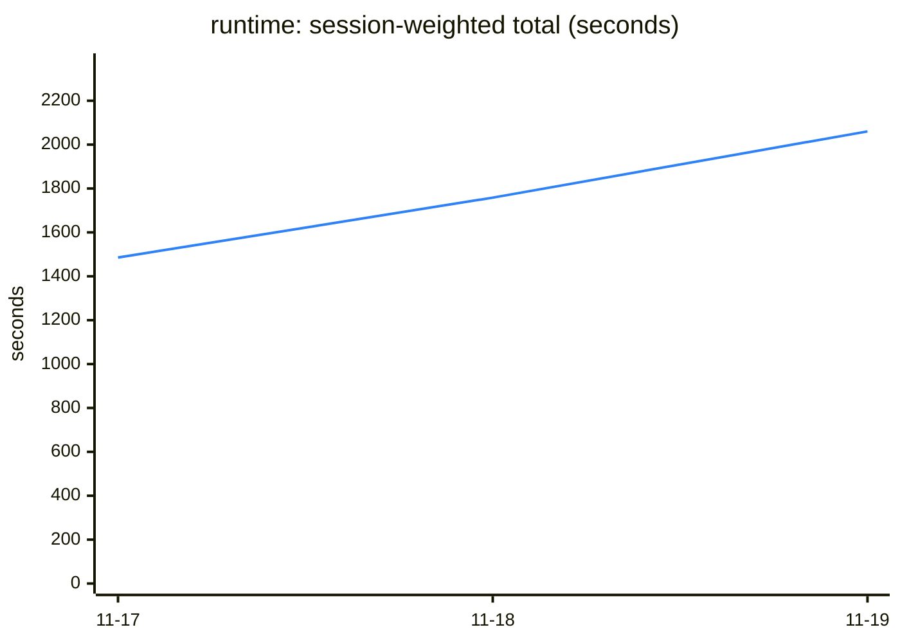

# Agent dev-loop benchmark — trend

3 runs, 2026-11-17 to 2026-11-19. Latest: `mxcli version 4fe3aa9 (2026-11-19T09:48:17Z)` against `mxcli version nightly-20261117-4fe3aa983 (2026-11-17T10:58:18Z)`.

Generated by `scripts/agentbench/trend` after each run; do not edit. Times are the candidate's median wall time on that night's runner, so two nights differ by the machine as well as by the code: read a level that stays, not one night's step. How to read it: `docs-site/src/internals/agent-benchmark.md` on `main`.

## Alerts

None.

## small project — 370 units



| step | latest | run before | median of the 7 before | against that median | against its baseline, latest | last runs |
|---|---:|---:|---:|---:|---:|---|
| (session-weighted total) | 132.6 s | 103.8 s | 93.6 s | × 1.42 | × 1.01 | ▁▄█ |
| open-cold | 192 ms | 199 ms | 165 ms | × 1.17 | × 0.95 | ▁██ |
| open | 66 ms | 57 ms | 50 ms | × 1.33 | × 0.98 | ▁▅█ |
| domain | 883 ms | 718 ms | 643 ms | × 1.37 | × 1.01 | ▁▄█ |
| microflows | 631 ms | 539 ms | 464 ms | × 1.36 | × 0.99 | ▁▅█ |
| pages | 2.00 s | 1.75 s | 1.53 s | × 1.31 | × 0.99 | ▁▆█ |
| describe | 160 ms | 126 ms | 114 ms | × 1.41 | × 1.00 | ▁▄█ |
| catalog | 281 ms | 219 ms | 192 ms | × 1.46 | × 0.97 | ▁▄█ |
| catalog-full | 1.45 s | 1.17 s | 1.03 s | × 1.41 | × 1.00 | ▁▄█ |
| query | 98 ms | 82 ms | 73 ms | × 1.35 | × 0.96 | ▁▅█ |
| check | 424 ms | 332 ms | 300 ms | × 1.41 | × 1.00 | ▁▄█ |
| single-edit | 445 ms | 342 ms | 310 ms | × 1.44 | × 1.00 | ▁▄█ |
| catalog-after-edit | 269 ms | 222 ms | 192 ms | × 1.40 | × 0.98 | ▁▅█ |
| bulk-alter | 1.45 s | 1.22 s | 1.08 s | × 1.35 | × 0.97 | ▁▅█ |
| re-exec | 723 ms | 610 ms | 551 ms | × 1.31 | × 0.99 | ▁▅█ |
| rename | 628 ms | 509 ms | 450 ms | × 1.39 | × 1.00 | ▁▄█ |

## large project — 910 units



| step | latest | run before | median of the 7 before | against that median | against its baseline, latest | last runs |
|---|---:|---:|---:|---:|---:|---|
| (session-weighted total) | 198.6 s | 153.5 s | 136.4 s | × 1.46 | × 1.01 | ▁▄█ |
| open-cold | 374 ms | 379 ms | 313 ms | × 1.20 | × 1.03 | ▁██ |
| open | 89 ms | 72 ms | 62 ms | × 1.43 | × 1.03 | ▁▅█ |
| domain | 1.04 s | 846 ms | 754 ms | × 1.39 | × 1.00 | ▁▄█ |
| microflows | 1.64 s | 1.12 s | 978 ms | × 1.68 | × 0.99 | ▁▃█ |
| pages | 2.55 s | 2.06 s | 1.80 s | × 1.42 | × 0.99 | ▁▅█ |
| describe | 205 ms | 150 ms | 134 ms | × 1.52 | × 1.01 | ▁▃█ |
| catalog | 441 ms | 332 ms | 289 ms | × 1.53 | × 1.01 | ▁▄█ |
| catalog-full | 4.60 s | 3.67 s | 3.26 s | × 1.41 | × 1.00 | ▁▄█ |
| query | 103 ms | 86 ms | 73 ms | × 1.41 | × 0.98 | ▁▅█ |
| check | 673 ms | 512 ms | 458 ms | × 1.47 | × 1.01 | ▁▄█ |
| single-edit | 652 ms | 506 ms | 451 ms | × 1.45 | × 1.01 | ▁▄█ |
| catalog-after-edit | 397 ms | 342 ms | 287 ms | × 1.38 | × 1.01 | ▁▆█ |
| bulk-alter | 1.80 s | 1.46 s | 1.29 s | × 1.40 | × 0.99 | ▁▅█ |
| re-exec | 1.04 s | 816 ms | 732 ms | × 1.42 | × 1.00 | ▁▄█ |
| rename | 1.30 s | 1.02 s | 900 ms | × 1.44 | × 1.00 | ▁▄█ |

## scale project — 4374 units



```mermaid
---
config:
  themeVariables:
    xyChart:
      plotColorPalette: "#2f81f7"
---
xychart-beta
    title "check-one (seconds)"
    x-axis ["11-17", "11-18", "11-19"]
    y-axis "seconds" 0 --> 0.87
    line [0.44, 0.56, 0.76]
```



| step | latest | run before | median of the 7 before | against that median | against its baseline, latest | last runs |
|---|---:|---:|---:|---:|---:|---|
| (session-weighted total) | 7.51 s | 5.93 s | 5.21 s | × 1.44 | × 1.01 | ▁▄█ |
| check-cold | 2.03 s | 1.69 s | 1.46 s | × 1.39 | × 1.02 | ▁▅█ |
| check-one | 756 ms | 555 ms | 499 ms | × 1.51 | × 0.99 | ▁▃█ |
| check-batch | 1.38 s | 1.04 s | 937 ms | × 1.47 | × 0.99 | ▁▃█ |
| exec-batch | 1.58 s | 1.22 s | 1.07 s | × 1.48 | × 1.00 | ▁▄█ |
| re-exec-batch | 776 ms | 607 ms | 550 ms | × 1.41 | × 1.01 | ▁▄█ |
| new-batch | 997 ms | 816 ms | 692 ms | × 1.44 | × 1.01 | ▁▅█ |

## running app — 476 units



| step | latest | run before | median of the 7 before | against that median | against its baseline, latest | last runs |
|---|---:|---:|---:|---:|---:|---|
| (session-weighted total) | 2060.3 s | 1758.3 s | 1621.8 s | × 1.27 | × 1.00 | ▁▄█ |
| mx-check | 8.18 s | 6.79 s | 6.13 s | × 1.34 | × 1.01 | ▁▄█ |
| build | 58.6 s | 53.3 s | 47.1 s | × 1.25 | × 0.99 | ▁▆█ |
| boot | 30.9 s | 26.1 s | 24.5 s | × 1.26 | × 1.03 | ▁▄█ |
| page-check | 3.32 s | 3.03 s | 2.87 s | × 1.16 | × 0.99 | ▁▅█ |
| hot-apply | 6.02 s | 5.17 s | 4.75 s | × 1.27 | × 1.00 | ▁▄█ |
| test-attach | 138 ms | 108 ms | 103 ms | × 1.35 | × 1.02 | ▁▃█ |
| apply-entity | 18.9 s | 16.3 s | 15.6 s | × 1.22 | × 1.00 | ▁▄█ |
| stop | 840 ms | 734 ms | 631 ms | × 1.33 | × 0.99 | ▁▆█ |
| test-cold | 25.7 s | 21.9 s | 20.3 s | × 1.26 | × 0.98 | ▁▄█ |
