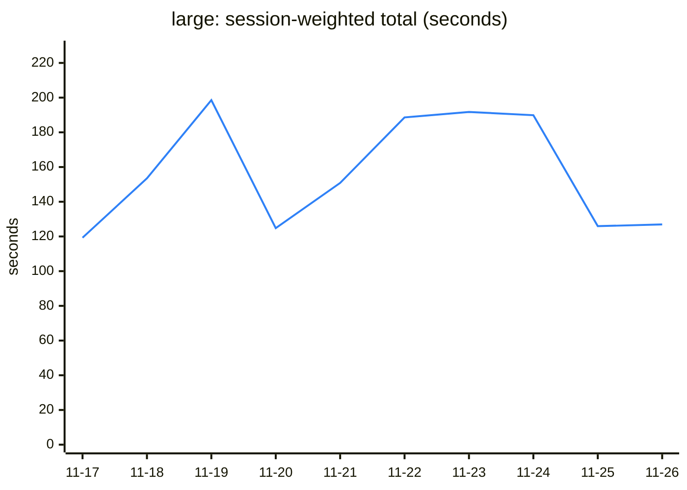
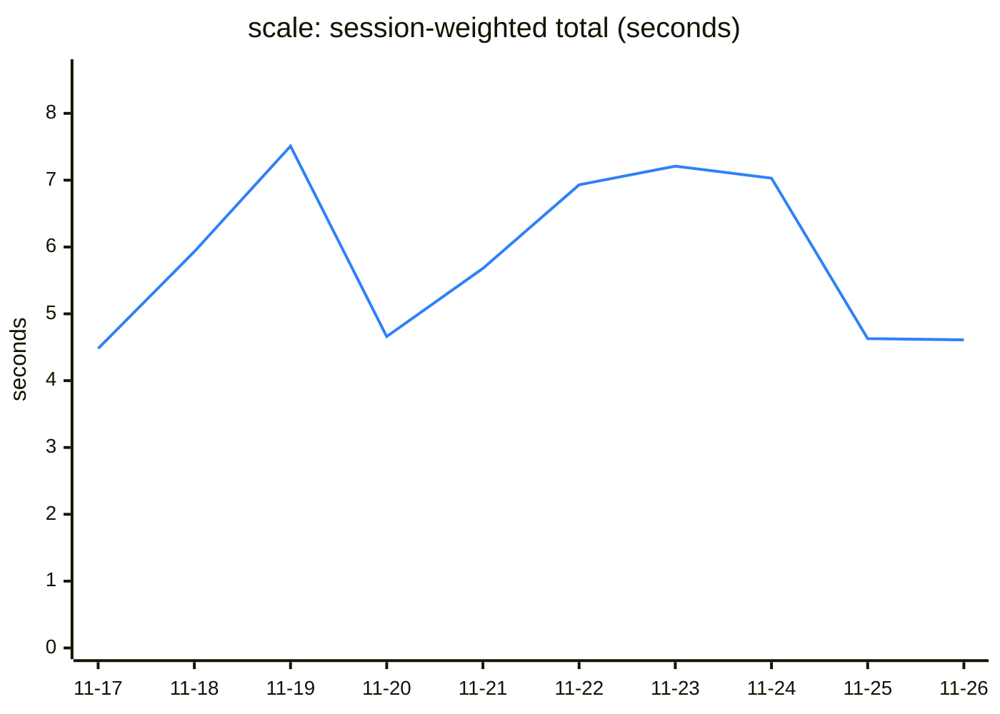
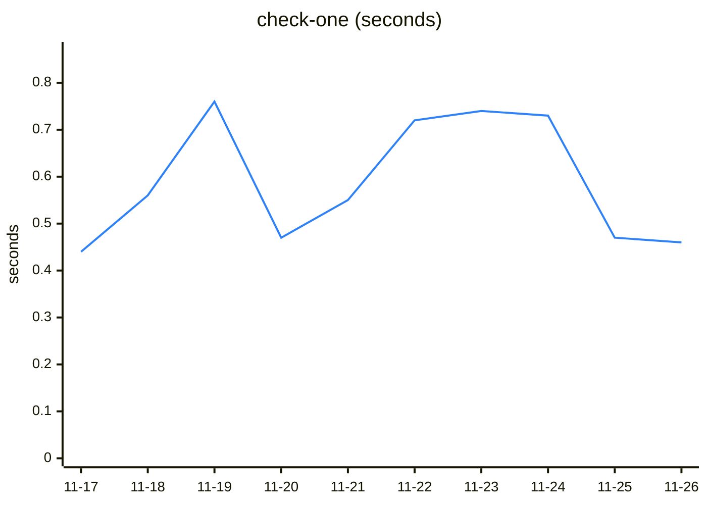
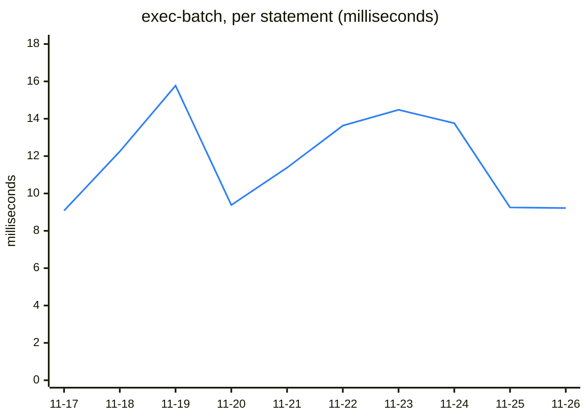
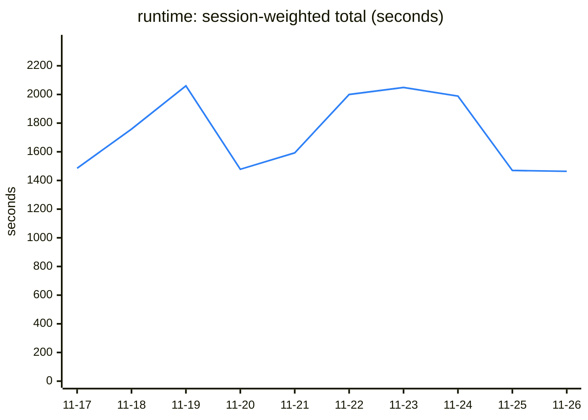

# Agent dev-loop benchmark — trend

10 runs, 2026-11-17 to 2026-11-26. Latest: `mxcli version 4fe3aa9 (2026-11-26T10:27:12Z)` against `mxcli version nightly-20261117-4fe3aa983 (2026-11-17T10:58:18Z)`.

Generated by `scripts/agentbench/trend` after each run; do not edit. Times are the candidate's median wall time on that night's runner, so two nights differ by the machine as well as by the code: read a level that stays, not one night's step. How to read it: `docs-site/src/internals/agent-benchmark.md` on `main`.

## Alerts

None.

## small project — 370 units

| step | latest | run before | median of the 7 before | against that median | against its baseline, latest | last runs |
|---|---:|---:|---:|---:|---:|---|
| (session-weighted total) | 87.7 s | 85.6 s | 125.6 s | × 0.70 | × 0.99 | ▁▄█▁▃▇█▇▁▁ |
| open-cold | 139 ms | 138 ms | 188 ms | × 0.74 | × 1.03 | ▁█▇▁█▇▇▆▁▂ |
| open | 45 ms | 42 ms | 66 ms | × 0.68 | × 1.03 | ▁▅█▂▅███▁▁ |
| domain | 584 ms | 575 ms | 837 ms | × 0.70 | × 1.01 | ▁▄█▁▂▇██▁▁ |
| microflows | 391 ms | 386 ms | 607 ms | × 0.64 | × 1.00 | ▁▅█▁▄███▁▁ |
| pages | 1.37 s | 1.32 s | 1.96 s | × 0.70 | × 1.00 | ▁▆█▁▄███▁▁ |
| describe | 105 ms | 108 ms | 153 ms | × 0.69 | × 0.99 | ▁▄█▁▃▇██▁▁ |
| catalog | 175 ms | 169 ms | 279 ms | × 0.63 | × 0.98 | ▁▄█▁▄▇██▁▁ |
| catalog-full | 924 ms | 915 ms | 1.41 s | × 0.66 | × 1.01 | ▁▄█▁▃███▁▁ |
| query | 66 ms | 63 ms | 96 ms | × 0.69 | × 1.02 | ▁▅█▁▄███▁▁ |
| check | 284 ms | 276 ms | 400 ms | × 0.71 | × 1.01 | ▁▄█▁▃▇█▇▁▁ |
| single-edit | 293 ms | 286 ms | 418 ms | × 0.70 | × 1.00 | ▁▄█▁▃▇█▇▁▁ |
| catalog-after-edit | 172 ms | 164 ms | 263 ms | × 0.65 | × 1.02 | ▁▅█▁▅███▁▁ |
| bulk-alter | 963 ms | 939 ms | 1.38 s | × 0.70 | × 1.00 | ▁▅█▁▄▇██▁▁ |
| re-exec | 508 ms | 487 ms | 699 ms | × 0.73 | × 1.00 | ▁▅█▁▃███▁▁ |
| rename | 408 ms | 400 ms | 607 ms | × 0.67 | × 1.01 | ▁▄█▁▃███▁▁ |

## large project — 910 units

| step | latest | run before | median of the 7 before | against that median | against its baseline, latest | last runs |
|---|---:|---:|---:|---:|---:|---|
| (session-weighted total) | 126.9 s | 125.9 s | 188.6 s | × 0.67 | × 1.01 | ▁▄█▁▄▇██▁▁ |
| open-cold | 260 ms | 252 ms | 353 ms | × 0.74 | × 1.01 | ▁██▁▆▇▇█▁▁ |
| open | 58 ms | 54 ms | 83 ms | × 0.70 | × 1.00 | ▁▅█▁▄▇██▁▂ |
| domain | 677 ms | 675 ms | 984 ms | × 0.69 | × 1.00 | ▁▄█▁▃▇█▇▁▁ |
| microflows | 896 ms | 883 ms | 1.53 s | × 0.59 | × 1.02 | ▁▃█▁▄▇██▁▁ |
| pages | 1.63 s | 1.62 s | 2.39 s | × 0.68 | × 1.01 | ▁▅█▁▆▇█▇▁▁ |
| describe | 125 ms | 125 ms | 185 ms | × 0.68 | × 1.01 | ▁▃█▁▃▇▇█▁▁ |
| catalog | 260 ms | 258 ms | 426 ms | × 0.61 | × 1.00 | ▁▄█▁▄███▁▁ |
| catalog-full | 2.89 s | 2.89 s | 4.43 s | × 0.65 | × 1.00 | ▁▄█▁▂███▁▁ |
| query | 69 ms | 68 ms | 99 ms | × 0.69 | × 0.99 | ▁▅█▁▄██▇▂▂ |
| check | 431 ms | 424 ms | 641 ms | × 0.67 | × 1.00 | ▁▄█▁▃███▁▁ |
| single-edit | 420 ms | 420 ms | 622 ms | × 0.68 | × 1.01 | ▁▄█▁▄███▁▁ |
| catalog-after-edit | 244 ms | 241 ms | 375 ms | × 0.65 | × 1.00 | ▁▆█▁▅▇██▁▁ |
| bulk-alter | 1.17 s | 1.15 s | 1.68 s | × 0.69 | × 1.00 | ▁▅█▁▄▇▇▇▁▁ |
| re-exec | 682 ms | 671 ms | 987 ms | × 0.69 | × 1.00 | ▁▄█▁▃▇██▁▁ |
| rename | 810 ms | 807 ms | 1.24 s | × 0.65 | × 1.00 | ▁▄█▁▃███▁▁ |

## scale project — 4374 units

| step | latest | run before | median of the 7 before | against that median | against its baseline, latest | last runs |
|---|---:|---:|---:|---:|---:|---|
| (session-weighted total) | 4.61 s | 4.63 s | 6.93 s | × 0.67 | × 1.01 | ▁▄█▁▄▇█▇▁▁ |
| check-cold | 1.27 s | 1.28 s | 1.90 s | × 0.67 | × 1.00 | ▁▅█▁▅▇██▁▁ |
| check-one | 461 ms | 466 ms | 716 ms | × 0.64 | × 1.01 | ▁▃█▁▃▇██▁▁ |
| check-batch | 872 ms | 860 ms | 1.28 s | × 0.68 | × 1.00 | ▁▃█▁▃▇█▇▁▁ |
| exec-batch | 922 ms | 925 ms | 1.36 s | × 0.68 | × 1.00 | ▁▄█▁▃▆▇▆▁▁ |
| re-exec-batch | 504 ms | 509 ms | 741 ms | × 0.68 | × 1.00 | ▁▄█▁▃▇██▁▁ |
| new-batch | 584 ms | 586 ms | 925 ms | × 0.63 | × 0.99 | ▁▅█▁▄▇█▇▁▁ |

## running app — 476 units

| step | latest | run before | median of the 7 before | against that median | against its baseline, latest | last runs |
|---|---:|---:|---:|---:|---:|---|
| (session-weighted total) | 1463.9 s | 1469.8 s | 1988.7 s | × 0.74 | × 1.00 | ▁▄█▁▂███▁▁ |
| mx-check | 5.52 s | 5.48 s | 8.18 s | × 0.68 | × 1.02 | ▁▄▇▁▂███▁▁ |
| build | 40.7 s | 41.6 s | 56.9 s | × 0.72 | × 0.98 | ▁▆█▁▅███▁▁ |
| boot | 20.8 s | 23.8 s | 28.8 s | × 0.72 | × 0.94 | ▂▅█▁▃██▇▃▁ |
| page-check | 2.73 s | 2.53 s | 3.23 s | × 0.85 | × 1.10 | ▃▅█▁▃▇██▁▃ |
| hot-apply | 4.34 s | 4.34 s | 5.25 s | × 0.83 | × 1.00 | ▁▄█▁▂▆▆▅▁▁ |
| test-attach | 94 ms | 92 ms | 138 ms | × 0.68 | × 0.90 | ▁▃▇▁▃▇██▁▁ |
| apply-entity | 14.0 s | 13.5 s | 18.2 s | × 0.77 | × 1.02 | ▂▅█▂▄▇██▁▁ |
| stop | 627 ms | 628 ms | 840 ms | × 0.75 | × 1.00 | ▁▆█▃▆███▃▃ |
| test-cold | 20.1 s | 18.7 s | 24.7 s | × 0.81 | × 1.02 | ▁▄█▁▁▇█▇▁▂ |
