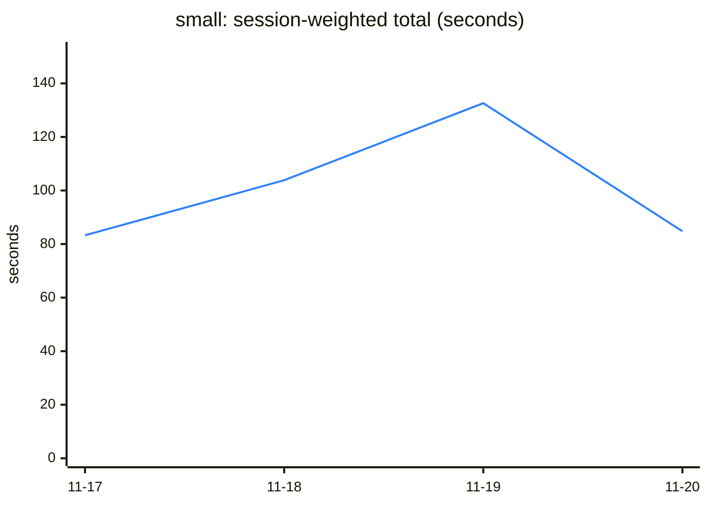
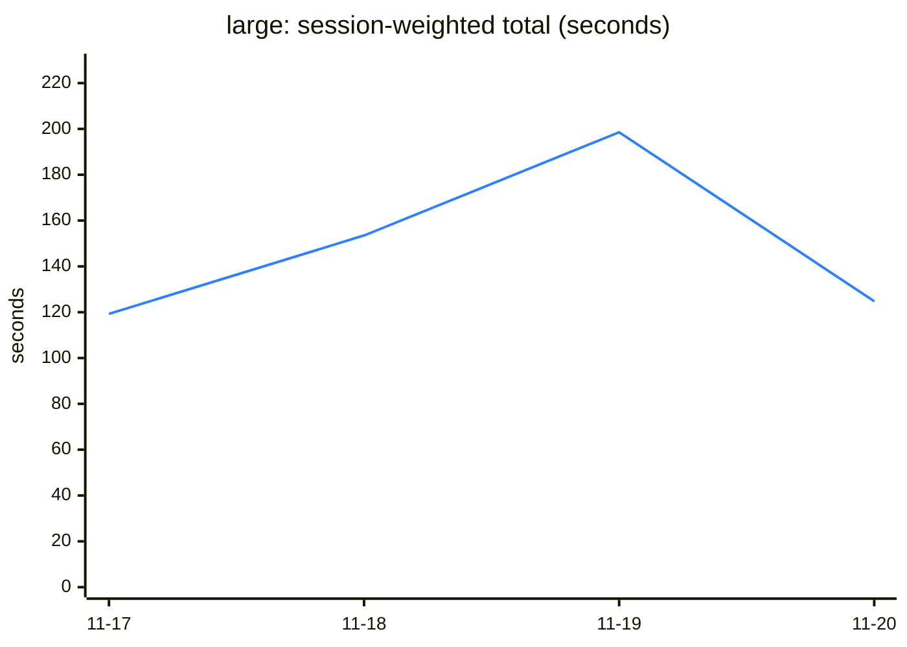
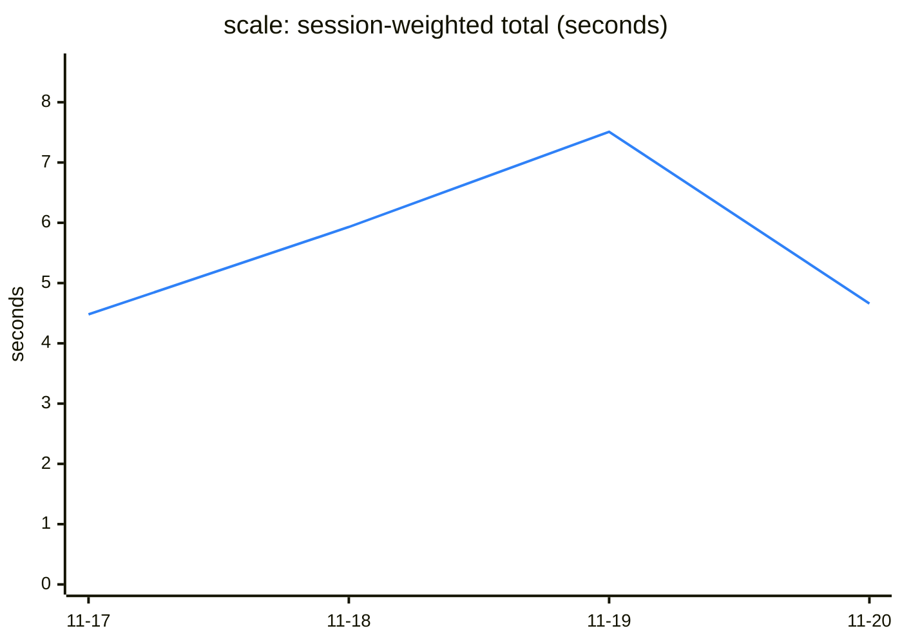
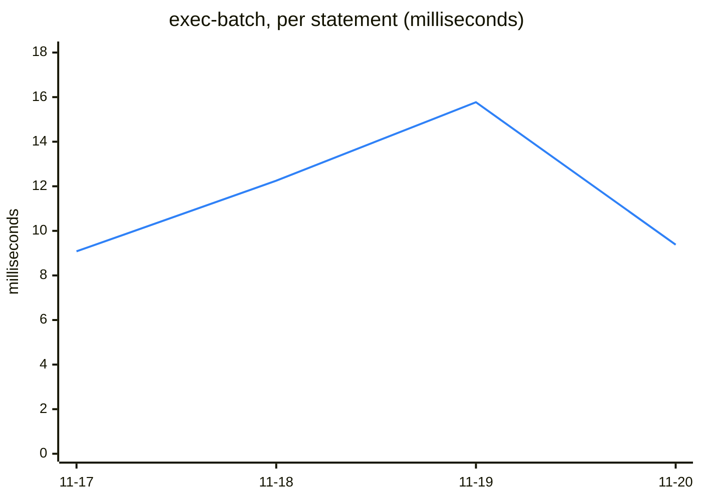
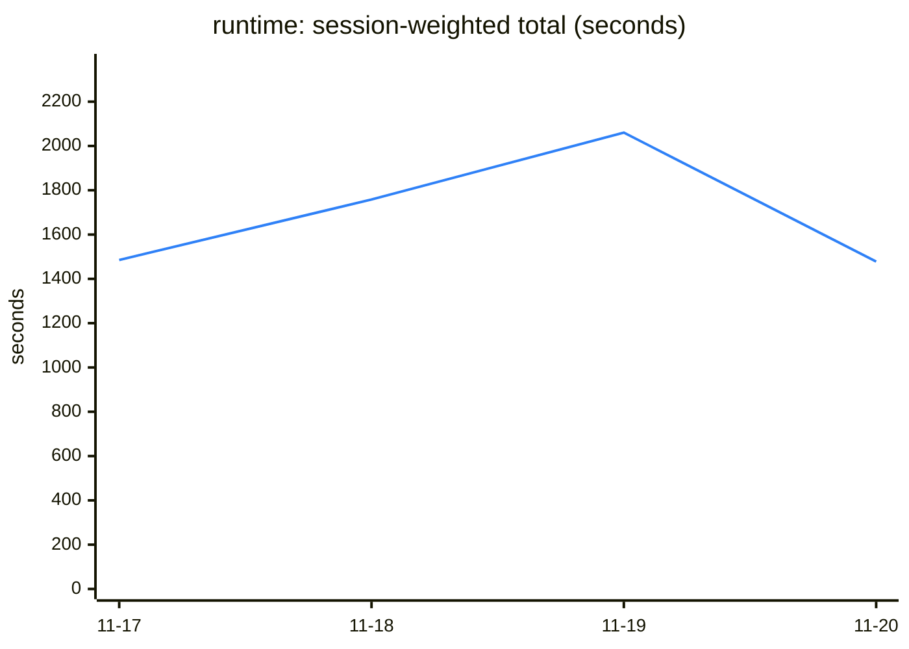

# Agent dev-loop benchmark — trend

4 runs, 2026-11-17 to 2026-11-20. Latest: `mxcli version 4fe3aa9 (2026-11-20T09:36:54Z)` against `mxcli version nightly-20261117-4fe3aa983 (2026-11-17T10:58:18Z)`.

Generated by `scripts/agentbench/trend` after each run; do not edit. Times are the candidate's median wall time on that night's runner, so two nights differ by the machine as well as by the code: read a level that stays, not one night's step. How to read it: `docs-site/src/internals/agent-benchmark.md` on `main`.

## Alerts

None.

## small project — 370 units



| step | latest | run before | median of the 7 before | against that median | against its baseline, latest | last runs |
|---|---:|---:|---:|---:|---:|---|
| (session-weighted total) | 84.8 s | 132.6 s | 103.8 s | × 0.82 | × 0.99 | ▁▄█▁ |
| open-cold | 129 ms | 192 ms | 192 ms | × 0.67 | × 0.98 | ▁██▁ |
| open | 45 ms | 66 ms | 57 ms | × 0.79 | × 1.01 | ▁▅█▁ |
| domain | 576 ms | 883 ms | 718 ms | × 0.80 | × 1.01 | ▁▄█▁ |
| microflows | 391 ms | 631 ms | 539 ms | × 0.73 | × 1.00 | ▁▅█▁ |
| pages | 1.33 s | 2.00 s | 1.75 s | × 0.76 | × 0.98 | ▁▆█▁ |
| describe | 105 ms | 160 ms | 126 ms | × 0.83 | × 0.98 | ▁▄█▁ |
| catalog | 169 ms | 281 ms | 219 ms | × 0.77 | × 1.00 | ▁▄█▁ |
| catalog-full | 922 ms | 1.45 s | 1.17 s | × 0.79 | × 1.02 | ▁▄█▁ |
| query | 62 ms | 98 ms | 82 ms | × 0.76 | × 0.97 | ▁▅█▁ |
| check | 275 ms | 424 ms | 332 ms | × 0.83 | × 0.99 | ▁▄█▁ |
| single-edit | 281 ms | 445 ms | 342 ms | × 0.82 | × 0.99 | ▁▄█▁ |
| catalog-after-edit | 166 ms | 269 ms | 222 ms | × 0.75 | × 0.98 | ▁▅█▁ |
| bulk-alter | 936 ms | 1.45 s | 1.22 s | × 0.77 | × 0.99 | ▁▅█▁ |
| re-exec | 491 ms | 723 ms | 610 ms | × 0.80 | × 1.00 | ▁▅█▁ |
| rename | 406 ms | 628 ms | 509 ms | × 0.80 | × 1.01 | ▁▄█▁ |

## large project — 910 units



| step | latest | run before | median of the 7 before | against that median | against its baseline, latest | last runs |
|---|---:|---:|---:|---:|---:|---|
| (session-weighted total) | 124.8 s | 198.6 s | 153.5 s | × 0.81 | × 1.00 | ▁▄█▁ |
| open-cold | 254 ms | 374 ms | 374 ms | × 0.68 | × 1.01 | ▁██▁ |
| open | 55 ms | 89 ms | 72 ms | × 0.76 | × 1.00 | ▁▅█▁ |
| domain | 671 ms | 1.04 s | 846 ms | × 0.79 | × 1.01 | ▁▄█▁ |
| microflows | 884 ms | 1.64 s | 1.12 s | × 0.79 | × 1.01 | ▁▃█▁ |
| pages | 1.64 s | 2.55 s | 2.06 s | × 0.79 | × 1.01 | ▁▅█▁ |
| describe | 124 ms | 205 ms | 150 ms | × 0.83 | × 0.97 | ▁▃█▁ |
| catalog | 254 ms | 441 ms | 332 ms | × 0.77 | × 1.00 | ▁▄█▁ |
| catalog-full | 2.88 s | 4.60 s | 3.67 s | × 0.78 | × 1.00 | ▁▄█▁ |
| query | 63 ms | 103 ms | 86 ms | × 0.74 | × 0.97 | ▁▅█▁ |
| check | 428 ms | 673 ms | 512 ms | × 0.83 | × 1.00 | ▁▄█▁ |
| single-edit | 411 ms | 652 ms | 506 ms | × 0.81 | × 0.99 | ▁▄█▁ |
| catalog-after-edit | 240 ms | 397 ms | 342 ms | × 0.70 | × 1.00 | ▁▆█▁ |
| bulk-alter | 1.15 s | 1.80 s | 1.46 s | × 0.79 | × 1.00 | ▁▅█▁ |
| re-exec | 666 ms | 1.04 s | 816 ms | × 0.82 | × 1.00 | ▁▄█▁ |
| rename | 801 ms | 1.30 s | 1.02 s | × 0.79 | × 0.99 | ▁▄█▁ |

## scale project — 4374 units



```mermaid
---
config:
  themeVariables:
    xyChart:
      plotColorPalette: "#2f81f7"
---
xychart-beta
    title "check-one (seconds)"
    x-axis ["11-17", "11-18", "11-19", "11-20"]
    y-axis "seconds" 0 --> 0.87
    line [0.44, 0.56, 0.76, 0.47]
```



| step | latest | run before | median of the 7 before | against that median | against its baseline, latest | last runs |
|---|---:|---:|---:|---:|---:|---|
| (session-weighted total) | 4.66 s | 7.51 s | 5.93 s | × 0.79 | × 1.01 | ▁▄█▁ |
| check-cold | 1.28 s | 2.03 s | 1.69 s | × 0.76 | × 0.99 | ▁▅█▁ |
| check-one | 469 ms | 756 ms | 555 ms | × 0.84 | × 1.00 | ▁▃█▁ |
| check-batch | 879 ms | 1.38 s | 1.04 s | × 0.85 | × 1.01 | ▁▃█▁ |
| exec-batch | 938 ms | 1.58 s | 1.22 s | × 0.77 | × 1.01 | ▁▄█▁ |
| re-exec-batch | 508 ms | 776 ms | 607 ms | × 0.84 | × 1.00 | ▁▄█▁ |
| new-batch | 585 ms | 997 ms | 816 ms | × 0.72 | × 1.01 | ▁▅█▁ |

## running app — 476 units



| step | latest | run before | median of the 7 before | against that median | against its baseline, latest | last runs |
|---|---:|---:|---:|---:|---:|---|
| (session-weighted total) | 1478.1 s | 2060.3 s | 1758.3 s | × 0.84 | × 1.00 | ▁▄█▁ |
| mx-check | 5.65 s | 8.18 s | 6.79 s | × 0.83 | × 1.01 | ▁▄█▁ |
| build | 42.2 s | 58.6 s | 53.3 s | × 0.79 | × 0.99 | ▁▆█▁ |
| boot | 20.8 s | 30.9 s | 26.1 s | × 0.80 | × 1.00 | ▂▅█▁ |
| page-check | 2.48 s | 3.32 s | 3.03 s | × 0.82 | × 1.00 | ▃▆█▁ |
| hot-apply | 4.34 s | 6.02 s | 5.17 s | × 0.84 | × 1.00 | ▁▄█▁ |
| test-attach | 92 ms | 138 ms | 108 ms | × 0.85 | × 0.97 | ▁▃█▁ |
| apply-entity | 14.8 s | 18.9 s | 16.3 s | × 0.90 | × 1.05 | ▁▄█▁ |
| stop | 628 ms | 840 ms | 734 ms | × 0.86 | × 1.00 | ▁▆█▃ |
| test-cold | 18.8 s | 25.7 s | 21.9 s | × 0.86 | × 0.98 | ▁▄█▁ |
