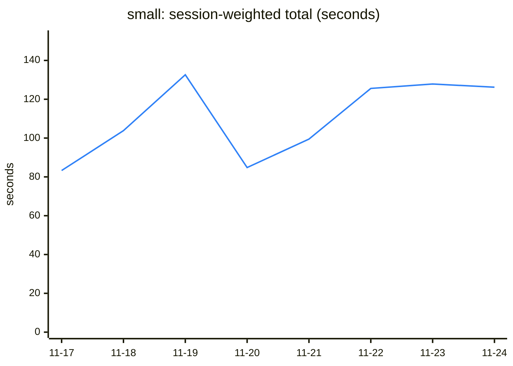
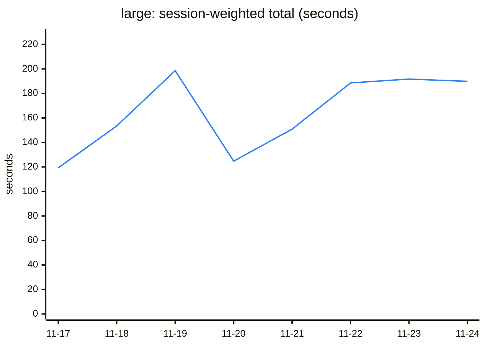
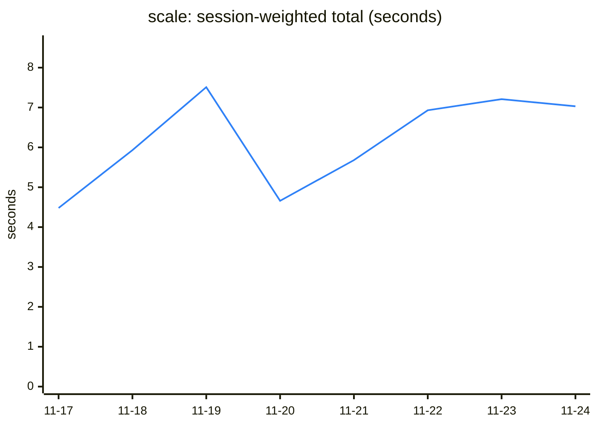
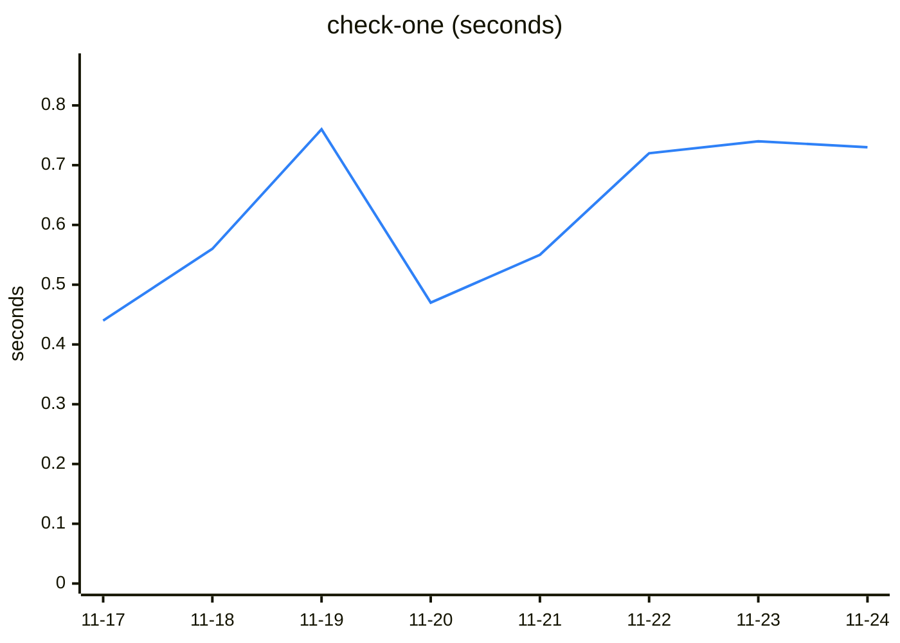
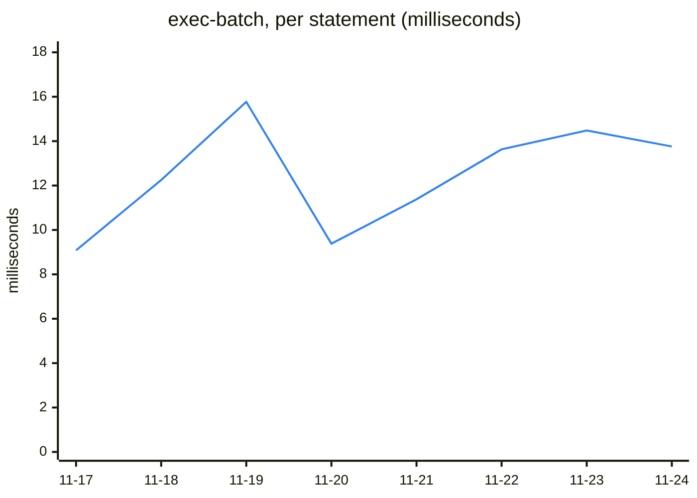
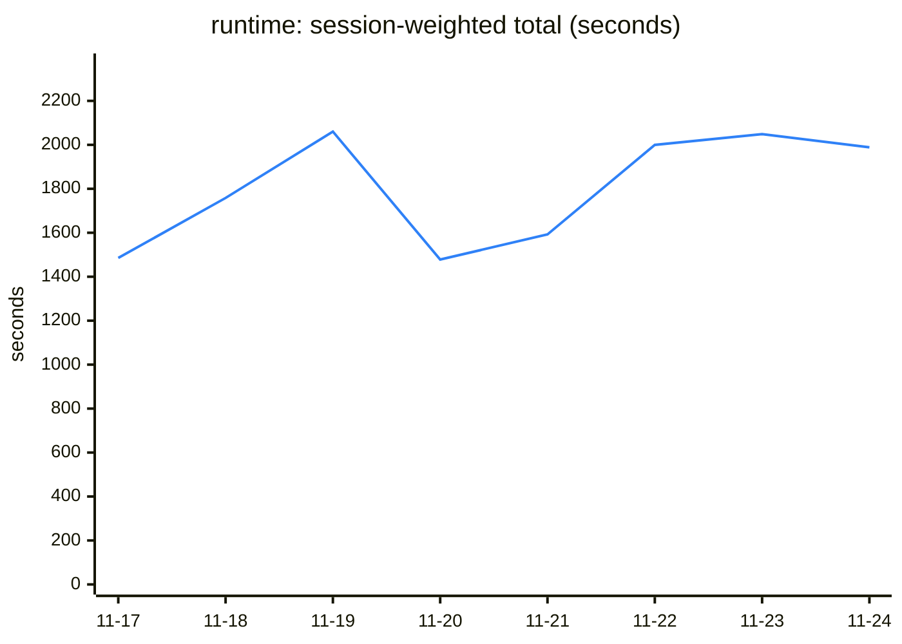

# Agent dev-loop benchmark — trend

8 runs, 2026-11-17 to 2026-11-24. Latest: `mxcli version 4fe3aa9 (2026-11-24T11:57:34Z)` against `mxcli version nightly-20261117-4fe3aa983 (2026-11-17T10:58:18Z)`.

Generated by `scripts/agentbench/trend` after each run; do not edit. Times are the candidate's median wall time on that night's runner, so two nights differ by the machine as well as by the code: read a level that stays, not one night's step. How to read it: `docs-site/src/internals/agent-benchmark.md` on `main`.

## Alerts

None.

## small project — 370 units

| step | latest | run before | median of the 7 before | against that median | against its baseline, latest | last runs |
|---|---:|---:|---:|---:|---:|---|
| (session-weighted total) | 126.2 s | 127.9 s | 103.8 s | × 1.22 | × 0.98 | ▁▄█▁▃▇█▇ |
| open-cold | 183 ms | 188 ms | 190 ms | × 0.97 | × 1.02 | ▁█▇▁█▇▇▆ |
| open | 66 ms | 67 ms | 57 ms | × 1.15 | × 1.01 | ▁▅█▁▅███ |
| domain | 847 ms | 851 ms | 718 ms | × 1.18 | × 1.00 | ▁▄█▁▂▇██ |
| microflows | 620 ms | 615 ms | 539 ms | × 1.15 | × 1.01 | ▁▅█▁▄███ |
| pages | 1.96 s | 1.97 s | 1.75 s | × 1.12 | × 1.00 | ▁▆█▁▄███ |
| describe | 155 ms | 158 ms | 126 ms | × 1.23 | × 1.03 | ▁▄█▁▃▇██ |
| catalog | 296 ms | 286 ms | 219 ms | × 1.35 | × 1.00 | ▁▄█▁▄▇██ |
| catalog-full | 1.44 s | 1.43 s | 1.17 s | × 1.23 | × 1.00 | ▁▄█▁▃███ |
| query | 97 ms | 96 ms | 82 ms | × 1.19 | × 1.00 | ▁▅█▁▄███ |
| check | 403 ms | 409 ms | 332 ms | × 1.21 | × 0.98 | ▁▄█▁▃▇█▇ |
| single-edit | 419 ms | 424 ms | 342 ms | × 1.23 | × 0.99 | ▁▄█▁▃▇█▇ |
| catalog-after-edit | 263 ms | 268 ms | 222 ms | × 1.18 | × 0.98 | ▁▅█▁▅███ |
| bulk-alter | 1.39 s | 1.39 s | 1.22 s | × 1.14 | × 1.00 | ▁▅█▁▄▇██ |
| re-exec | 709 ms | 715 ms | 610 ms | × 1.16 | × 1.00 | ▁▅█▁▃███ |
| rename | 615 ms | 618 ms | 509 ms | × 1.21 | × 1.00 | ▁▄█▁▃███ |

## large project — 910 units

| step | latest | run before | median of the 7 before | against that median | against its baseline, latest | last runs |
|---|---:|---:|---:|---:|---:|---|
| (session-weighted total) | 189.9 s | 191.7 s | 153.5 s | × 1.24 | × 1.00 | ▁▄█▁▄▇██ |
| open-cold | 363 ms | 357 ms | 353 ms | × 1.03 | × 1.04 | ▁██▁▆▇▇█ |
| open | 85 ms | 88 ms | 72 ms | × 1.17 | × 1.01 | ▁▅█▁▄▇██ |
| domain | 995 ms | 1.01 s | 846 ms | × 1.18 | × 1.00 | ▁▄█▁▃▇█▇ |
| microflows | 1.55 s | 1.58 s | 1.19 s | × 1.30 | × 1.00 | ▁▃█▁▄▇██ |
| pages | 2.42 s | 2.44 s | 2.19 s | × 1.10 | × 1.01 | ▁▅█▁▆▇█▇ |
| describe | 195 ms | 187 ms | 150 ms | × 1.30 | × 1.03 | ▁▃█▁▃▇▇█ |
| catalog | 430 ms | 429 ms | 332 ms | × 1.30 | × 1.01 | ▁▄█▁▄███ |
| catalog-full | 4.52 s | 4.52 s | 3.67 s | × 1.23 | × 1.00 | ▁▄█▁▂███ |
| query | 99 ms | 100 ms | 86 ms | × 1.16 | × 0.99 | ▁▅█▁▄██▇ |
| check | 641 ms | 654 ms | 512 ms | × 1.25 | × 1.00 | ▁▄█▁▃███ |
| single-edit | 624 ms | 631 ms | 506 ms | × 1.23 | × 0.99 | ▁▄█▁▄███ |
| catalog-after-edit | 386 ms | 383 ms | 342 ms | × 1.13 | × 1.04 | ▁▆█▁▅▇██ |
| bulk-alter | 1.69 s | 1.71 s | 1.46 s | × 1.16 | × 1.00 | ▁▅█▁▄▇▇▇ |
| re-exec | 990 ms | 997 ms | 816 ms | × 1.21 | × 1.00 | ▁▄█▁▃▇██ |
| rename | 1.24 s | 1.26 s | 1.02 s | × 1.22 | × 0.99 | ▁▄█▁▃███ |

## scale project — 4374 units

| step | latest | run before | median of the 7 before | against that median | against its baseline, latest | last runs |
|---|---:|---:|---:|---:|---:|---|
| (session-weighted total) | 7.03 s | 7.21 s | 5.93 s | × 1.19 | × 0.99 | ▁▄█▁▄▇█▇ |
| check-cold | 1.96 s | 1.99 s | 1.69 s | × 1.16 | × 1.00 | ▁▅█▁▅▇██ |
| check-one | 727 ms | 745 ms | 555 ms | × 1.31 | × 1.00 | ▁▃█▁▃▇██ |
| check-batch | 1.29 s | 1.33 s | 1.04 s | × 1.25 | × 1.00 | ▁▃█▁▃▇█▇ |
| exec-batch | 1.38 s | 1.45 s | 1.22 s | × 1.12 | × 0.99 | ▁▄█▁▃▆▇▆ |
| re-exec-batch | 742 ms | 757 ms | 607 ms | × 1.22 | × 1.00 | ▁▄█▁▃▇██ |
| new-batch | 925 ms | 948 ms | 816 ms | × 1.13 | × 0.99 | ▁▅█▁▄▇█▇ |

## running app — 476 units

| step | latest | run before | median of the 7 before | against that median | against its baseline, latest | last runs |
|---|---:|---:|---:|---:|---:|---|
| (session-weighted total) | 1988.7 s | 2048.7 s | 1758.3 s | × 1.13 | × 1.00 | ▁▄█▁▂███ |
| mx-check | 8.31 s | 8.57 s | 6.79 s | × 1.22 | × 1.00 | ▁▄▇▁▂███ |
| build | 57.4 s | 58.4 s | 53.3 s | × 1.08 | × 1.01 | ▁▆█▁▅███ |
| boot | 28.8 s | 29.9 s | 26.1 s | × 1.11 | × 0.98 | ▂▅█▁▃██▇ |
| page-check | 3.37 s | 3.28 s | 3.03 s | × 1.11 | × 1.04 | ▃▅█▁▃▇██ |
| hot-apply | 5.25 s | 5.52 s | 5.17 s | × 1.02 | × 1.00 | ▁▄█▁▂▆▆▅ |
| test-attach | 146 ms | 139 ms | 110 ms | × 1.32 | × 1.08 | ▁▃▇▁▃▇██ |
| apply-entity | 18.4 s | 18.7 s | 16.3 s | × 1.13 | × 1.00 | ▁▄█▁▃▇█▇ |
| stop | 841 ms | 842 ms | 734 ms | × 1.15 | × 1.00 | ▁▆█▃▆███ |
| test-cold | 24.7 s | 26.5 s | 21.9 s | × 1.13 | × 1.00 | ▁▄█▁▁▇█▇ |
