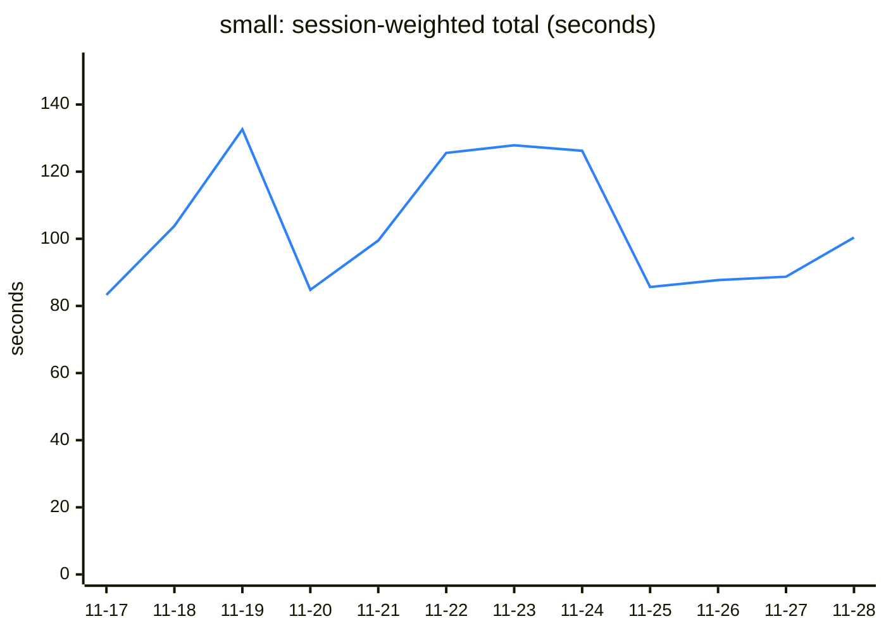
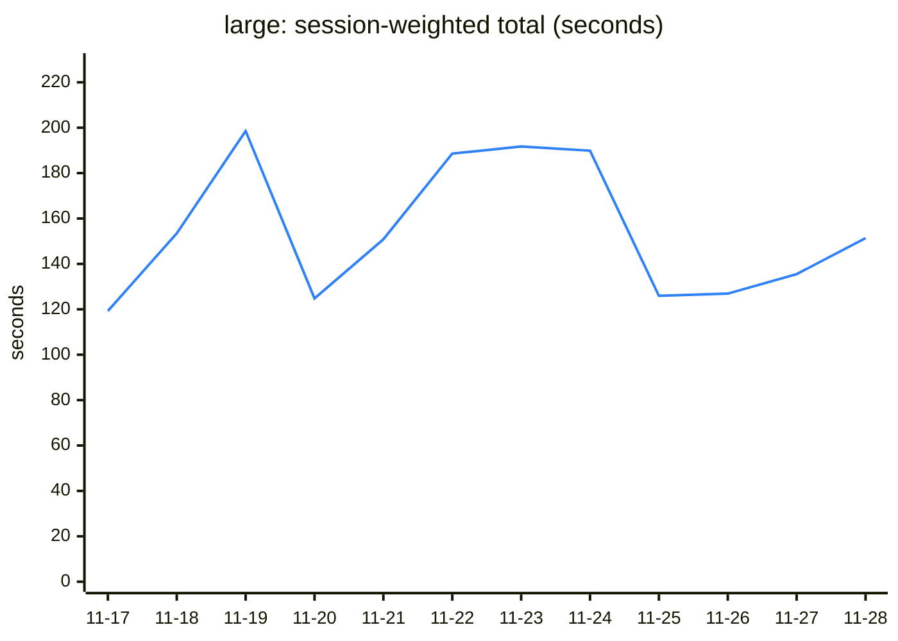
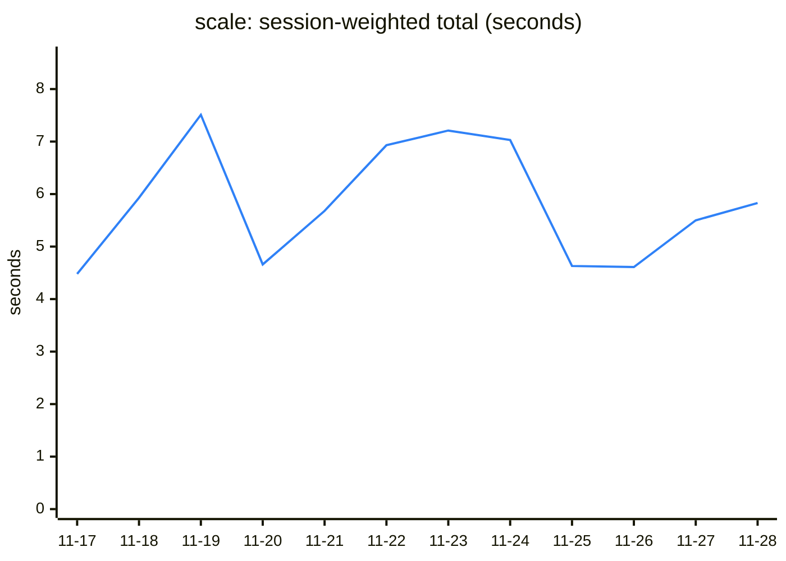
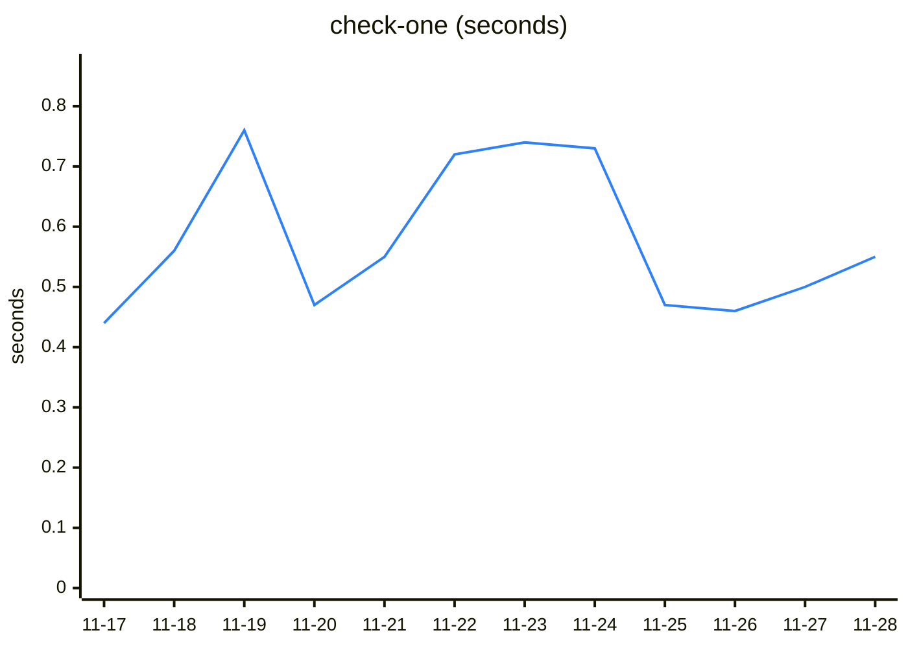
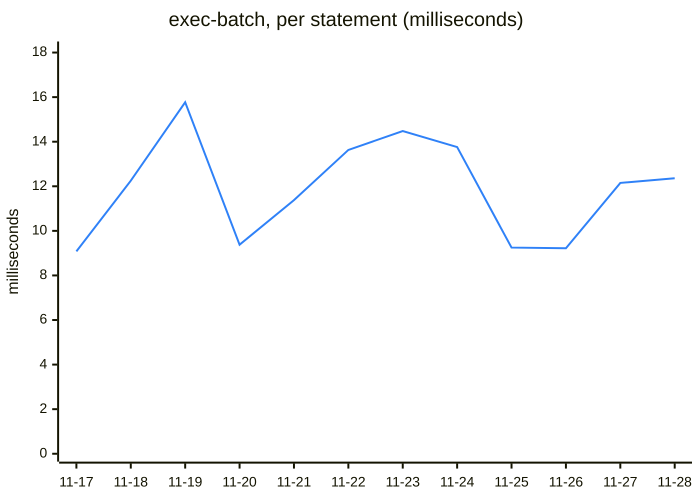
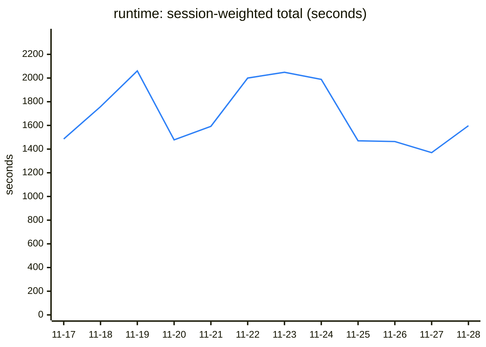

# Agent dev-loop benchmark — trend

12 runs, 2026-11-17 to 2026-11-28. Latest: `mxcli version 4fe3aa9 (2026-11-28T09:44:45Z)` against `mxcli version nightly-20261117-4fe3aa983 (2026-11-17T10:58:18Z)`.

Generated by `scripts/agentbench/trend` after each run; do not edit. Times are the candidate's median wall time on that night's runner, so two nights differ by the machine as well as by the code: read a level that stays, not one night's step. How to read it: `docs-site/src/internals/agent-benchmark.md` on `main`.

## Alerts

None.

## small project — 370 units

| step | latest | run before | median of the 7 before | against that median | against its baseline, latest | last runs |
|---|---:|---:|---:|---:|---:|---|
| (session-weighted total) | 100.4 s | 88.7 s | 99.5 s | × 1.01 | × 0.99 | ▁▄█▁▃▇█▇▁▁▁▃ |
| open-cold | 192 ms | 165 ms | 183 ms | × 1.05 | × 1.03 | ▁█▇▁█▇▇▆▁▂▄▇ |
| open | 53 ms | 48 ms | 56 ms | × 0.95 | × 1.02 | ▁▅█▂▅███▁▁▃▄ |
| domain | 648 ms | 565 ms | 644 ms | × 1.01 | × 1.01 | ▁▄█▁▂▇██▁▁▁▃ |
| microflows | 474 ms | 440 ms | 499 ms | × 0.95 | × 0.95 | ▁▅█▁▄███▁▁▂▃ |
| pages | 1.53 s | 1.43 s | 1.57 s | × 0.97 | × 1.00 | ▁▆█▁▄███▁▁▂▃ |
| describe | 125 ms | 105 ms | 120 ms | × 1.04 | × 0.99 | ▁▄█▁▃▇██▁▁▁▄ |
| catalog | 216 ms | 175 ms | 218 ms | × 0.99 | × 0.98 | ▁▄█▁▄▇██▁▁▁▄ |
| catalog-full | 1.06 s | 906 ms | 1.05 s | × 1.00 | × 1.01 | ▁▄█▁▃███▁▁▁▃ |
| query | 81 ms | 67 ms | 76 ms | × 1.07 | × 1.00 | ▁▅█▁▄███▁▁▂▅ |
| check | 319 ms | 285 ms | 318 ms | × 1.01 | × 0.99 | ▁▄█▁▃▇█▇▁▁▁▃ |
| single-edit | 333 ms | 296 ms | 329 ms | × 1.01 | × 0.98 | ▁▄█▁▃▇█▇▁▁▁▃ |
| catalog-after-edit | 219 ms | 185 ms | 221 ms | × 0.99 | × 1.02 | ▁▅█▁▅███▁▁▂▅ |
| bulk-alter | 1.11 s | 1.02 s | 1.14 s | × 0.97 | × 1.01 | ▁▅█▁▄▇██▁▁▂▃ |
| re-exec | 556 ms | 498 ms | 559 ms | × 1.00 | × 1.01 | ▁▅█▁▃███▁▁▁▃ |
| rename | 460 ms | 403 ms | 477 ms | × 0.96 | × 1.00 | ▁▄█▁▃███▁▁▁▃ |

## large project — 910 units

| step | latest | run before | median of the 7 before | against that median | against its baseline, latest | last runs |
|---|---:|---:|---:|---:|---:|---|
| (session-weighted total) | 151.4 s | 135.5 s | 150.8 s | × 1.00 | × 1.00 | ▁▄█▁▄▇██▁▁▂▄ |
| open-cold | 363 ms | 309 ms | 339 ms | × 1.07 | × 0.98 | ▁██▁▆▇▇█▁▁▄█ |
| open | 73 ms | 59 ms | 67 ms | × 1.09 | × 0.97 | ▁▅█▁▄▇██▁▂▂▅ |
| domain | 777 ms | 691 ms | 769 ms | × 1.01 | × 0.99 | ▁▄█▁▃▇█▇▁▁▁▃ |
| microflows | 1.16 s | 1.09 s | 1.19 s | × 0.98 | × 0.99 | ▁▃█▁▄▇██▁▁▃▄ |
| pages | 1.93 s | 1.82 s | 2.19 s | × 0.88 | × 1.00 | ▁▅█▁▆▇█▇▁▁▃▄ |
| describe | 151 ms | 137 ms | 145 ms | × 1.04 | × 1.01 | ▁▃█▁▃▇▇█▁▁▂▃ |
| catalog | 332 ms | 286 ms | 326 ms | × 1.02 | × 0.98 | ▁▄█▁▄███▁▁▂▄ |
| catalog-full | 3.28 s | 3.02 s | 3.28 s | × 1.00 | × 1.01 | ▁▄█▁▂███▁▁▁▂ |
| query | 83 ms | 75 ms | 81 ms | × 1.03 | × 1.03 | ▁▅█▁▄██▇▂▂▃▅ |
| check | 507 ms | 456 ms | 502 ms | × 1.01 | × 1.00 | ▁▄█▁▃███▁▁▂▄ |
| single-edit | 501 ms | 447 ms | 504 ms | × 0.99 | × 1.00 | ▁▄█▁▄███▁▁▂▄ |
| catalog-after-edit | 330 ms | 305 ms | 322 ms | × 1.03 | × 1.02 | ▁▆█▁▅▇██▁▁▄▅ |
| bulk-alter | 1.35 s | 1.28 s | 1.37 s | × 0.98 | × 1.00 | ▁▅█▁▄▇▇▇▁▁▂▃ |
| re-exec | 775 ms | 725 ms | 776 ms | × 1.00 | × 0.99 | ▁▄█▁▃▇██▁▁▂▃ |
| rename | 926 ms | 823 ms | 936 ms | × 0.99 | × 1.00 | ▁▄█▁▃███▁▁▁▃ |

## scale project — 4374 units

| step | latest | run before | median of the 7 before | against that median | against its baseline, latest | last runs |
|---|---:|---:|---:|---:|---:|---|
| (session-weighted total) | 5.83 s | 5.50 s | 5.68 s | × 1.03 | × 1.00 | ▁▄█▁▄▇█▇▁▁▃▄ |
| check-cold | 1.67 s | 1.51 s | 1.67 s | × 1.00 | × 1.03 | ▁▅█▁▅▇██▁▁▃▅ |
| check-one | 554 ms | 498 ms | 555 ms | × 1.00 | × 0.99 | ▁▃█▁▃▇██▁▁▂▃ |
| check-batch | 978 ms | 905 ms | 977 ms | × 1.00 | × 0.99 | ▁▃█▁▃▇█▇▁▁▂▃ |
| exec-batch | 1.24 s | 1.22 s | 1.22 s | × 1.02 | × 0.97 | ▁▄█▁▃▆▇▆▁▁▄▄ |
| re-exec-batch | 602 ms | 557 ms | 592 ms | × 1.02 | × 0.99 | ▁▄█▁▃▇██▁▁▂▄ |
| new-batch | 799 ms | 817 ms | 817 ms | × 0.98 | × 1.02 | ▁▅█▁▄▇█▇▁▁▅▅ |

## running app — 476 units

| step | latest | run before | median of the 7 before | against that median | against its baseline, latest | last runs |
|---|---:|---:|---:|---:|---:|---|
| (session-weighted total) | 1597.6 s | 1370.3 s | 1592.5 s | × 1.00 | × 1.02 | ▂▅█▂▃███▂▂▁▃ |
| mx-check | 5.94 s | 4.65 s | 5.88 s | × 1.01 | × 0.99 | ▂▅█▃▃███▂▂▁▃ |
| build | 49.0 s | 43.5 s | 50.0 s | × 0.98 | × 1.01 | ▁▆█▁▅███▁▁▂▄ |
| boot | 24.3 s | 20.3 s | 23.8 s | × 1.02 | × 1.04 | ▂▅█▁▃██▇▃▁▁▄ |
| page-check | 2.87 s | 2.48 s | 2.74 s | × 1.05 | × 1.02 | ▃▅█▁▃▇██▁▃▁▄ |
| hot-apply | 4.64 s | 4.34 s | 4.64 s | × 1.00 | × 1.00 | ▁▄█▁▂▆▆▅▁▁▁▂ |
| test-attach | 112 ms | 100 ms | 110 ms | × 1.02 | × 1.09 | ▁▃▇▁▃▇██▁▁▂▄ |
| apply-entity | 15.3 s | 14.0 s | 15.8 s | × 0.97 | × 1.03 | ▂▅█▂▄▇██▁▁▁▃ |
| stop | 734 ms | 731 ms | 733 ms | × 1.00 | × 0.88 | ▁▆█▃▆███▃▃▆▆ |
| test-cold | 19.8 s | 16.4 s | 20.1 s | × 0.99 | × 1.06 | ▂▅█▂▃▇█▇▂▃▁▃ |
