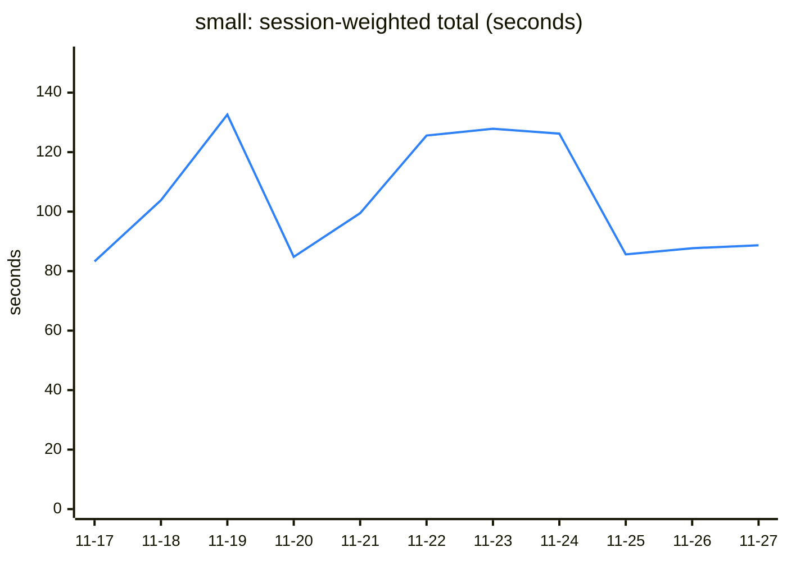
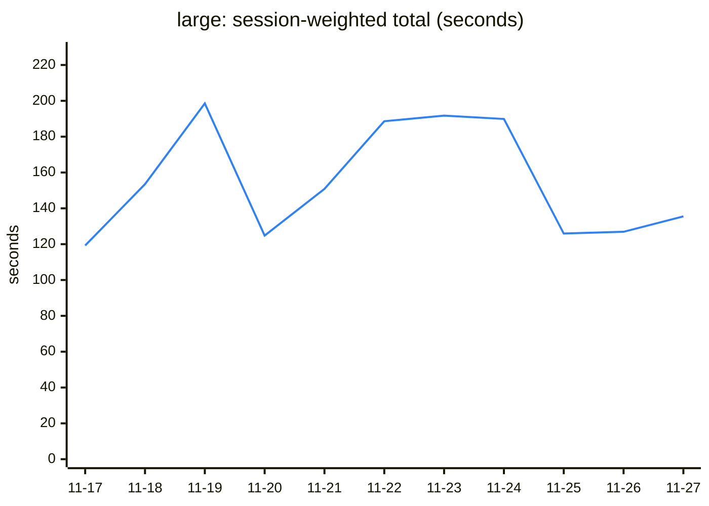
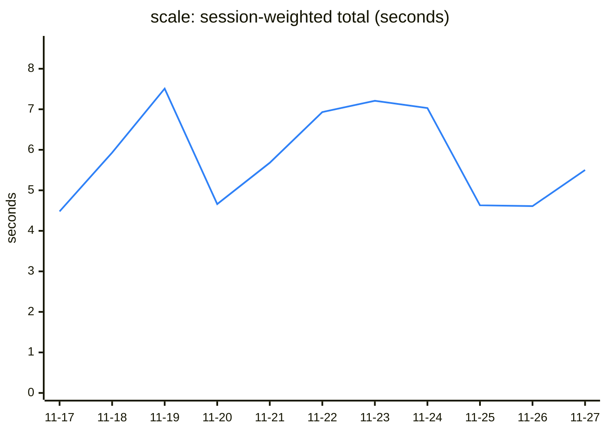
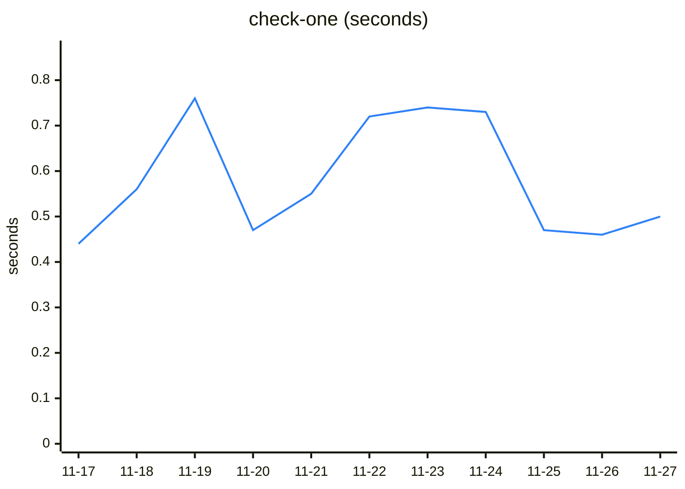
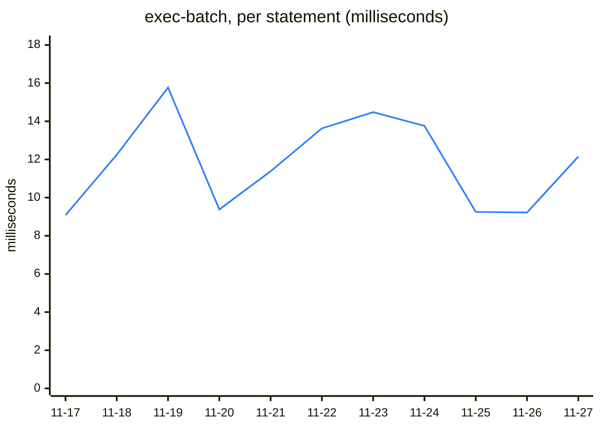
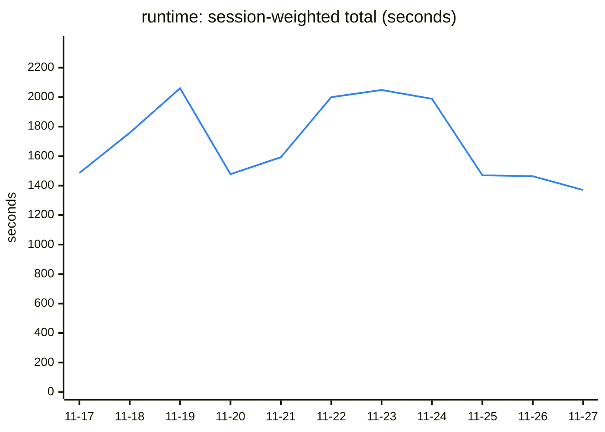

# Agent dev-loop benchmark — trend

11 runs, 2026-11-17 to 2026-11-27. Latest: `mxcli version 4fe3aa9 (2026-11-27T10:28:42Z)` against `mxcli version nightly-20261117-4fe3aa983 (2026-11-17T10:58:18Z)`.

Generated by `scripts/agentbench/trend` after each run; do not edit. Times are the candidate's median wall time on that night's runner, so two nights differ by the machine as well as by the code: read a level that stays, not one night's step. How to read it: `docs-site/src/internals/agent-benchmark.md` on `main`.

## Alerts

None.

## small project — 370 units

| step | latest | run before | median of the 7 before | against that median | against its baseline, latest | last runs |
|---|---:|---:|---:|---:|---:|---|
| (session-weighted total) | 88.7 s | 87.7 s | 99.5 s | × 0.89 | × 1.00 | ▁▄█▁▃▇█▇▁▁▁ |
| open-cold | 165 ms | 139 ms | 183 ms | × 0.90 | × 0.96 | ▁█▇▁█▇▇▆▁▂▄ |
| open | 48 ms | 45 ms | 56 ms | × 0.86 | × 0.99 | ▁▅█▂▅███▁▁▃ |
| domain | 565 ms | 584 ms | 644 ms | × 0.88 | × 1.01 | ▁▄█▁▂▇██▁▁▁ |
| microflows | 440 ms | 391 ms | 499 ms | × 0.88 | × 0.99 | ▁▅█▁▄███▁▁▂ |
| pages | 1.43 s | 1.37 s | 1.57 s | × 0.91 | × 1.02 | ▁▆█▁▄███▁▁▂ |
| describe | 105 ms | 105 ms | 120 ms | × 0.88 | × 0.97 | ▁▄█▁▃▇██▁▁▁ |
| catalog | 175 ms | 175 ms | 218 ms | × 0.80 | × 1.00 | ▁▄█▁▄▇██▁▁▁ |
| catalog-full | 906 ms | 924 ms | 1.05 s | × 0.86 | × 1.06 | ▁▄█▁▃███▁▁▁ |
| query | 67 ms | 66 ms | 76 ms | × 0.87 | × 0.96 | ▁▅█▁▄███▁▁▂ |
| check | 285 ms | 284 ms | 318 ms | × 0.90 | × 1.02 | ▁▄█▁▃▇█▇▁▁▁ |
| single-edit | 296 ms | 293 ms | 329 ms | × 0.90 | × 1.01 | ▁▄█▁▃▇█▇▁▁▁ |
| catalog-after-edit | 185 ms | 172 ms | 221 ms | × 0.84 | × 0.98 | ▁▅█▁▅███▁▁▂ |
| bulk-alter | 1.02 s | 963 ms | 1.14 s | × 0.89 | × 1.02 | ▁▅█▁▄▇██▁▁▂ |
| re-exec | 498 ms | 508 ms | 559 ms | × 0.89 | × 1.01 | ▁▅█▁▃███▁▁▁ |
| rename | 403 ms | 408 ms | 477 ms | × 0.84 | × 1.02 | ▁▄█▁▃███▁▁▁ |

## large project — 910 units

| step | latest | run before | median of the 7 before | against that median | against its baseline, latest | last runs |
|---|---:|---:|---:|---:|---:|---|
| (session-weighted total) | 135.5 s | 126.9 s | 150.8 s | × 0.90 | × 1.00 | ▁▄█▁▄▇██▁▁▂ |
| open-cold | 309 ms | 260 ms | 339 ms | × 0.91 | × 1.04 | ▁██▁▆▇▇█▁▁▄ |
| open | 59 ms | 58 ms | 67 ms | × 0.88 | × 0.94 | ▁▅█▁▄▇██▁▂▂ |
| domain | 691 ms | 677 ms | 769 ms | × 0.90 | × 0.97 | ▁▄█▁▃▇█▇▁▁▁ |
| microflows | 1.09 s | 896 ms | 1.19 s | × 0.92 | × 1.01 | ▁▃█▁▄▇██▁▁▃ |
| pages | 1.82 s | 1.63 s | 2.19 s | × 0.83 | × 1.03 | ▁▅█▁▆▇█▇▁▁▃ |
| describe | 137 ms | 125 ms | 145 ms | × 0.95 | × 0.99 | ▁▃█▁▃▇▇█▁▁▂ |
| catalog | 286 ms | 260 ms | 326 ms | × 0.88 | × 1.02 | ▁▄█▁▄███▁▁▂ |
| catalog-full | 3.02 s | 2.89 s | 3.28 s | × 0.92 | × 1.04 | ▁▄█▁▂███▁▁▁ |
| query | 75 ms | 69 ms | 81 ms | × 0.93 | × 1.01 | ▁▅█▁▄██▇▂▂▃ |
| check | 456 ms | 431 ms | 502 ms | × 0.91 | × 0.99 | ▁▄█▁▃███▁▁▂ |
| single-edit | 447 ms | 420 ms | 504 ms | × 0.89 | × 1.00 | ▁▄█▁▄███▁▁▂ |
| catalog-after-edit | 305 ms | 244 ms | 322 ms | × 0.95 | × 1.01 | ▁▆█▁▅▇██▁▁▄ |
| bulk-alter | 1.28 s | 1.17 s | 1.37 s | × 0.93 | × 1.01 | ▁▅█▁▄▇▇▇▁▁▂ |
| re-exec | 725 ms | 682 ms | 776 ms | × 0.94 | × 1.02 | ▁▄█▁▃▇██▁▁▂ |
| rename | 823 ms | 810 ms | 936 ms | × 0.88 | × 1.02 | ▁▄█▁▃███▁▁▁ |

## scale project — 4374 units

| step | latest | run before | median of the 7 before | against that median | against its baseline, latest | last runs |
|---|---:|---:|---:|---:|---:|---|
| (session-weighted total) | 5.50 s | 4.61 s | 5.68 s | × 0.97 | × 1.02 | ▁▄█▁▄▇█▇▁▁▃ |
| check-cold | 1.51 s | 1.27 s | 1.67 s | × 0.91 | × 1.07 | ▁▅█▁▅▇██▁▁▃ |
| check-one | 498 ms | 461 ms | 555 ms | × 0.90 | × 1.00 | ▁▃█▁▃▇██▁▁▂ |
| check-batch | 905 ms | 872 ms | 977 ms | × 0.93 | × 0.99 | ▁▃█▁▃▇█▇▁▁▂ |
| exec-batch | 1.22 s | 922 ms | 1.14 s | × 1.07 | × 1.02 | ▁▄█▁▃▆▇▆▁▁▄ |
| re-exec-batch | 557 ms | 504 ms | 592 ms | × 0.94 | × 1.01 | ▁▄█▁▃▇██▁▁▂ |
| new-batch | 817 ms | 584 ms | 755 ms | × 1.08 | × 0.94 | ▁▅█▁▄▇█▇▁▁▅ |

## running app — 476 units

| step | latest | run before | median of the 7 before | against that median | against its baseline, latest | last runs |
|---|---:|---:|---:|---:|---:|---|
| (session-weighted total) | 1370.3 s | 1463.9 s | 1592.5 s | × 0.86 | × 0.99 | ▂▅█▂▃███▂▂▁ |
| mx-check | 4.65 s | 5.52 s | 5.88 s | × 0.79 | × 0.98 | ▂▅█▃▃███▂▂▁ |
| build | 43.5 s | 40.7 s | 50.0 s | × 0.87 | × 1.02 | ▁▆█▁▅███▁▁▂ |
| boot | 20.3 s | 20.8 s | 23.8 s | × 0.85 | × 1.03 | ▂▅█▁▃██▇▃▁▁ |
| page-check | 2.48 s | 2.73 s | 2.74 s | × 0.91 | × 1.01 | ▃▅█▁▃▇██▁▃▁ |
| hot-apply | 4.34 s | 4.34 s | 4.64 s | × 0.93 | × 1.05 | ▁▄█▁▂▆▆▅▁▁▁ |
| test-attach | 100 ms | 94 ms | 110 ms | × 0.90 | × 1.07 | ▁▃▇▁▃▇██▁▁▂ |
| apply-entity | 14.0 s | 14.0 s | 15.8 s | × 0.89 | × 0.96 | ▂▅█▂▄▇██▁▁▁ |
| stop | 731 ms | 627 ms | 733 ms | × 1.00 | × 1.00 | ▁▆█▃▆███▃▃▆ |
| test-cold | 16.4 s | 20.1 s | 20.1 s | × 0.82 | × 0.94 | ▂▅█▂▃▇█▇▂▃▁ |
