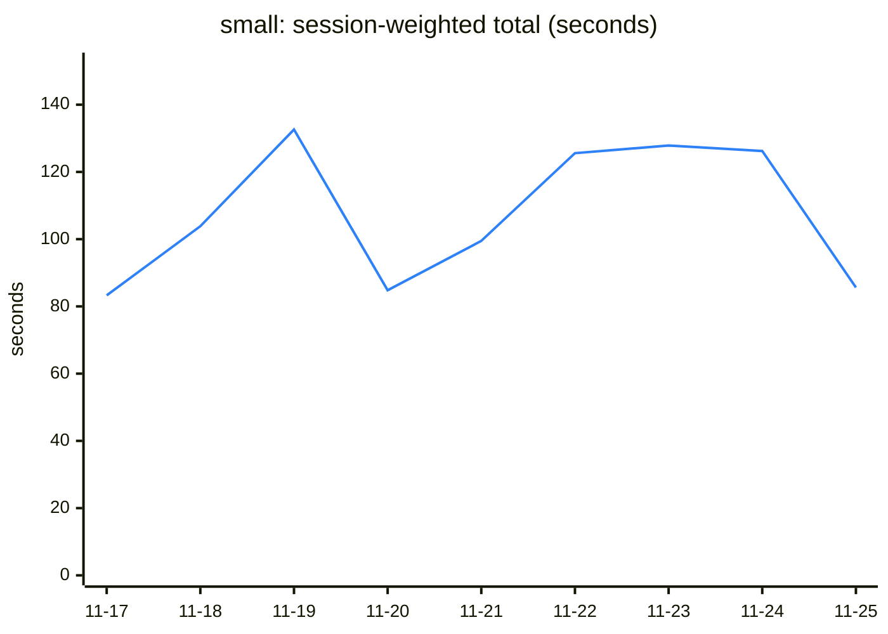
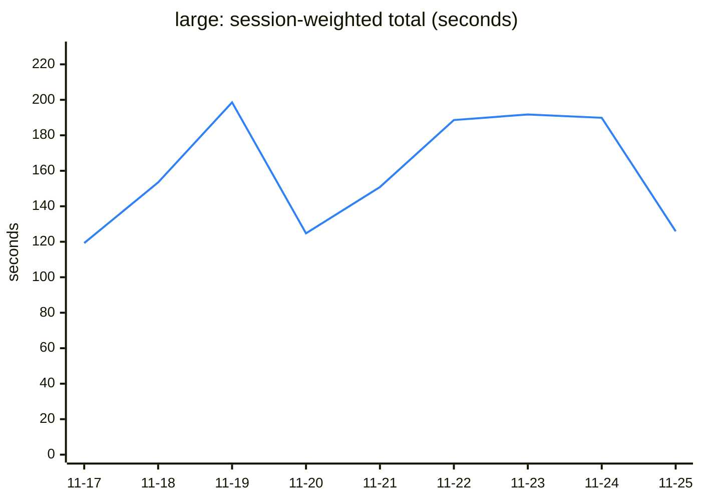
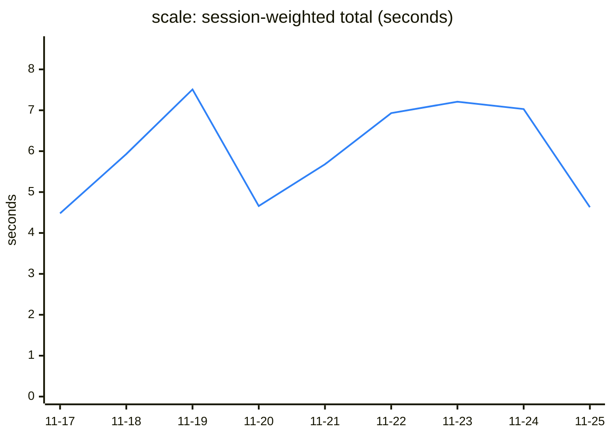
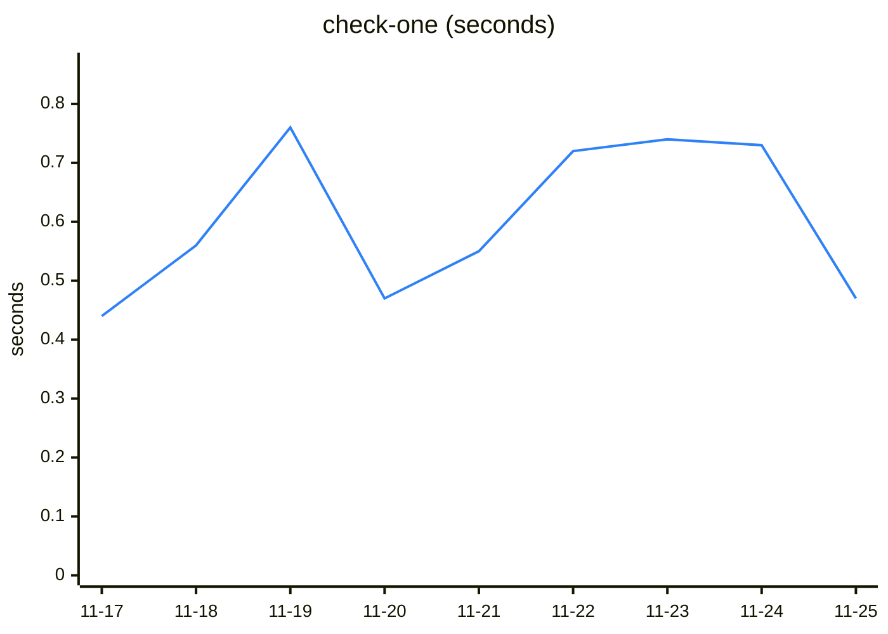
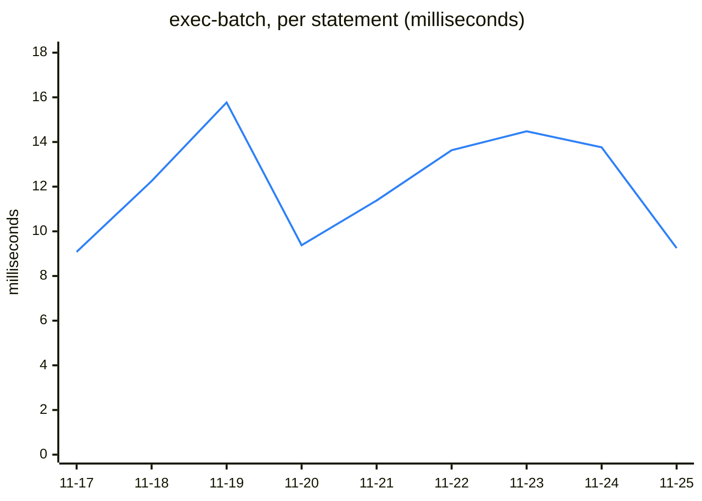
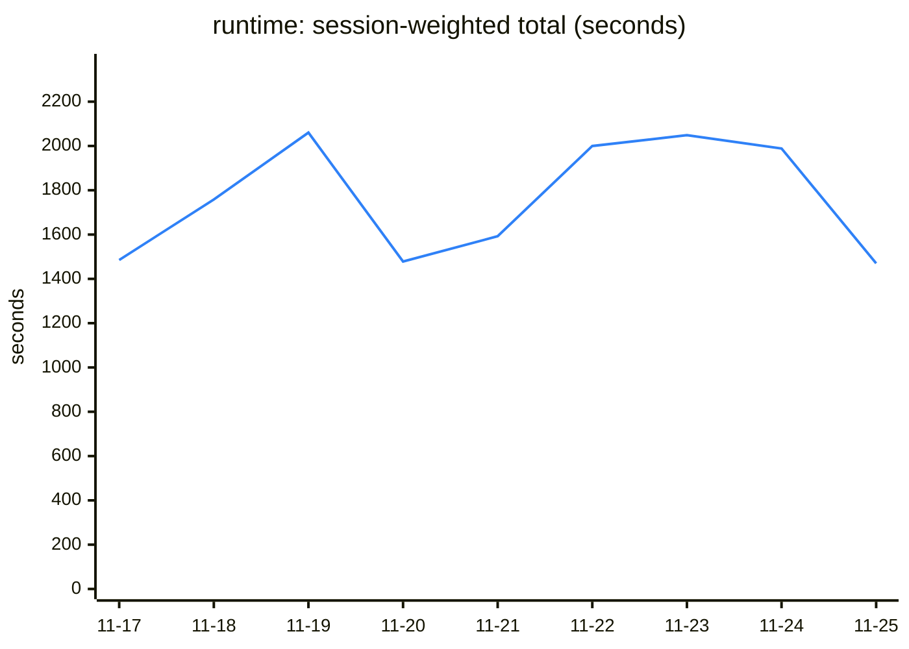

# Agent dev-loop benchmark — trend

9 runs, 2026-11-17 to 2026-11-25. Latest: `mxcli version 4fe3aa9 (2026-11-25T10:50:04Z)` against `mxcli version nightly-20261117-4fe3aa983 (2026-11-17T10:58:18Z)`.

Generated by `scripts/agentbench/trend` after each run; do not edit. Times are the candidate's median wall time on that night's runner, so two nights differ by the machine as well as by the code: read a level that stays, not one night's step. How to read it: `docs-site/src/internals/agent-benchmark.md` on `main`.

## Alerts

None.

## small project — 370 units

| step | latest | run before | median of the 7 before | against that median | against its baseline, latest | last runs |
|---|---:|---:|---:|---:|---:|---|
| (session-weighted total) | 85.6 s | 126.2 s | 125.6 s | × 0.68 | × 0.99 | ▁▄█▁▃▇█▇▁ |
| open-cold | 138 ms | 183 ms | 190 ms | × 0.73 | × 1.05 | ▁█▇▁█▇▇▆▁ |
| open | 42 ms | 66 ms | 66 ms | × 0.63 | × 0.93 | ▁▅█▂▅███▁ |
| domain | 575 ms | 847 ms | 837 ms | × 0.69 | × 1.01 | ▁▄█▁▂▇██▁ |
| microflows | 386 ms | 620 ms | 607 ms | × 0.64 | × 1.02 | ▁▅█▁▄███▁ |
| pages | 1.32 s | 1.96 s | 1.96 s | × 0.68 | × 0.99 | ▁▆█▁▄███▁ |
| describe | 108 ms | 155 ms | 153 ms | × 0.71 | × 1.02 | ▁▄█▁▃▇██▁ |
| catalog | 169 ms | 296 ms | 279 ms | × 0.61 | × 1.00 | ▁▄█▁▄▇██▁ |
| catalog-full | 915 ms | 1.44 s | 1.41 s | × 0.65 | × 1.00 | ▁▄█▁▃███▁ |
| query | 63 ms | 97 ms | 96 ms | × 0.65 | × 1.01 | ▁▅█▁▄███▁ |
| check | 276 ms | 403 ms | 400 ms | × 0.69 | × 0.99 | ▁▄█▁▃▇█▇▁ |
| single-edit | 286 ms | 419 ms | 418 ms | × 0.68 | × 0.99 | ▁▄█▁▃▇█▇▁ |
| catalog-after-edit | 164 ms | 263 ms | 263 ms | × 0.62 | × 1.00 | ▁▅█▁▅███▁ |
| bulk-alter | 939 ms | 1.39 s | 1.38 s | × 0.68 | × 1.00 | ▁▅█▁▄▇██▁ |
| re-exec | 487 ms | 709 ms | 699 ms | × 0.70 | × 1.00 | ▁▅█▁▃███▁ |
| rename | 400 ms | 615 ms | 607 ms | × 0.66 | × 1.00 | ▁▄█▁▃███▁ |

## large project — 910 units

| step | latest | run before | median of the 7 before | against that median | against its baseline, latest | last runs |
|---|---:|---:|---:|---:|---:|---|
| (session-weighted total) | 125.9 s | 189.9 s | 188.6 s | × 0.67 | × 1.01 | ▁▄█▁▄▇██▁ |
| open-cold | 252 ms | 363 ms | 357 ms | × 0.71 | × 1.00 | ▁██▁▆▇▇█▁ |
| open | 54 ms | 85 ms | 83 ms | × 0.66 | × 1.00 | ▁▅█▁▄▇██▁ |
| domain | 675 ms | 995 ms | 984 ms | × 0.69 | × 1.00 | ▁▄█▁▃▇█▇▁ |
| microflows | 883 ms | 1.55 s | 1.53 s | × 0.58 | × 1.00 | ▁▃█▁▄▇██▁ |
| pages | 1.62 s | 2.42 s | 2.39 s | × 0.68 | × 1.00 | ▁▅█▁▆▇█▇▁ |
| describe | 125 ms | 195 ms | 185 ms | × 0.68 | × 1.04 | ▁▃█▁▃▇▇█▁ |
| catalog | 258 ms | 430 ms | 426 ms | × 0.60 | × 0.99 | ▁▄█▁▄███▁ |
| catalog-full | 2.89 s | 4.52 s | 4.43 s | × 0.65 | × 1.00 | ▁▄█▁▂███▁ |
| query | 68 ms | 99 ms | 99 ms | × 0.68 | × 0.99 | ▁▅█▁▄██▇▂ |
| check | 424 ms | 641 ms | 641 ms | × 0.66 | × 1.01 | ▁▄█▁▃███▁ |
| single-edit | 420 ms | 624 ms | 622 ms | × 0.68 | × 1.01 | ▁▄█▁▄███▁ |
| catalog-after-edit | 241 ms | 386 ms | 375 ms | × 0.64 | × 1.01 | ▁▆█▁▅▇██▁ |
| bulk-alter | 1.15 s | 1.69 s | 1.68 s | × 0.69 | × 1.00 | ▁▅█▁▄▇▇▇▁ |
| re-exec | 671 ms | 990 ms | 987 ms | × 0.68 | × 0.99 | ▁▄█▁▃▇██▁ |
| rename | 807 ms | 1.24 s | 1.24 s | × 0.65 | × 1.00 | ▁▄█▁▃███▁ |

## scale project — 4374 units

| step | latest | run before | median of the 7 before | against that median | against its baseline, latest | last runs |
|---|---:|---:|---:|---:|---:|---|
| (session-weighted total) | 4.63 s | 7.03 s | 6.93 s | × 0.67 | × 1.00 | ▁▄█▁▄▇█▇▁ |
| check-cold | 1.28 s | 1.96 s | 1.90 s | × 0.67 | × 1.01 | ▁▅█▁▅▇██▁ |
| check-one | 466 ms | 727 ms | 716 ms | × 0.65 | × 1.01 | ▁▃█▁▃▇██▁ |
| check-batch | 860 ms | 1.29 s | 1.28 s | × 0.67 | × 1.00 | ▁▃█▁▃▇█▇▁ |
| exec-batch | 925 ms | 1.38 s | 1.36 s | × 0.68 | × 1.00 | ▁▄█▁▃▆▇▆▁ |
| re-exec-batch | 509 ms | 742 ms | 741 ms | × 0.69 | × 1.01 | ▁▄█▁▃▇██▁ |
| new-batch | 586 ms | 925 ms | 925 ms | × 0.63 | × 0.99 | ▁▅█▁▄▇█▇▁ |

## running app — 476 units

| step | latest | run before | median of the 7 before | against that median | against its baseline, latest | last runs |
|---|---:|---:|---:|---:|---:|---|
| (session-weighted total) | 1469.8 s | 1988.7 s | 1988.7 s | × 0.74 | × 1.00 | ▁▄█▁▂███▁ |
| mx-check | 5.48 s | 8.31 s | 8.18 s | × 0.67 | × 1.00 | ▁▄▇▁▂███▁ |
| build | 41.6 s | 57.4 s | 56.9 s | × 0.73 | × 0.99 | ▁▆█▁▅███▁ |
| boot | 23.8 s | 28.8 s | 28.8 s | × 0.83 | × 1.13 | ▂▅█▁▃██▇▃ |
| page-check | 2.53 s | 3.37 s | 3.23 s | × 0.78 | × 1.03 | ▃▅█▁▃▇██▁ |
| hot-apply | 4.34 s | 5.25 s | 5.25 s | × 0.83 | × 1.00 | ▁▄█▁▂▆▆▅▁ |
| test-attach | 92 ms | 146 ms | 138 ms | × 0.67 | × 0.92 | ▁▃▇▁▃▇██▁ |
| apply-entity | 13.5 s | 18.4 s | 18.2 s | × 0.74 | × 0.97 | ▂▅█▂▄▇██▁ |
| stop | 628 ms | 841 ms | 840 ms | × 0.75 | × 1.00 | ▁▆█▃▆███▃ |
| test-cold | 18.7 s | 24.7 s | 24.7 s | × 0.76 | × 1.06 | ▁▄█▁▁▇█▇▁ |
