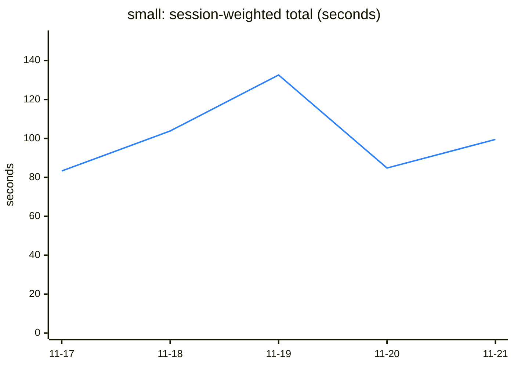
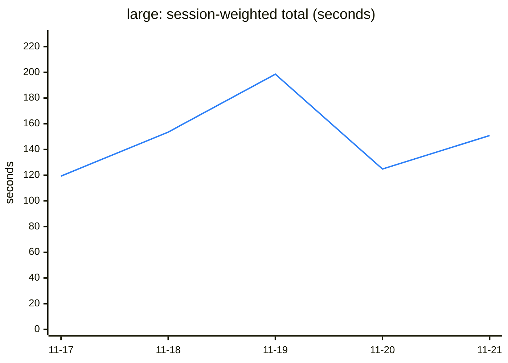
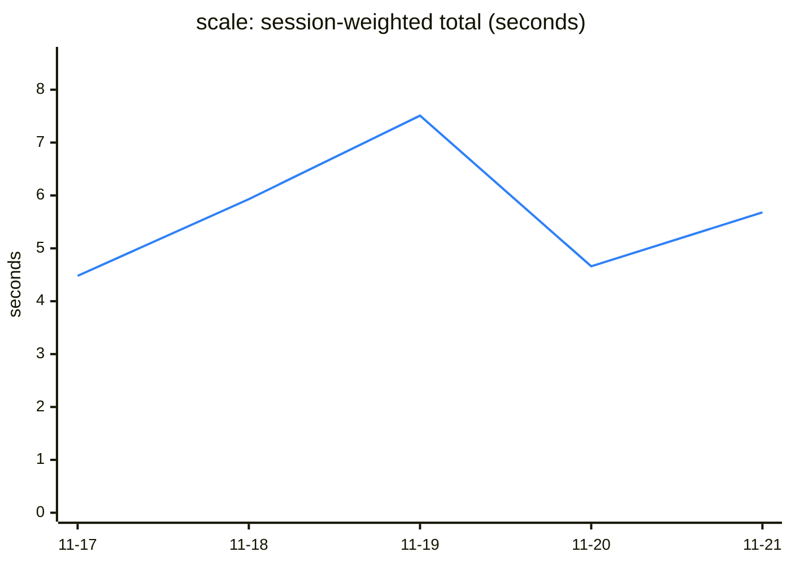
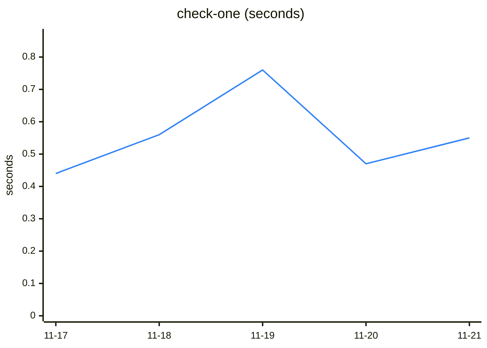
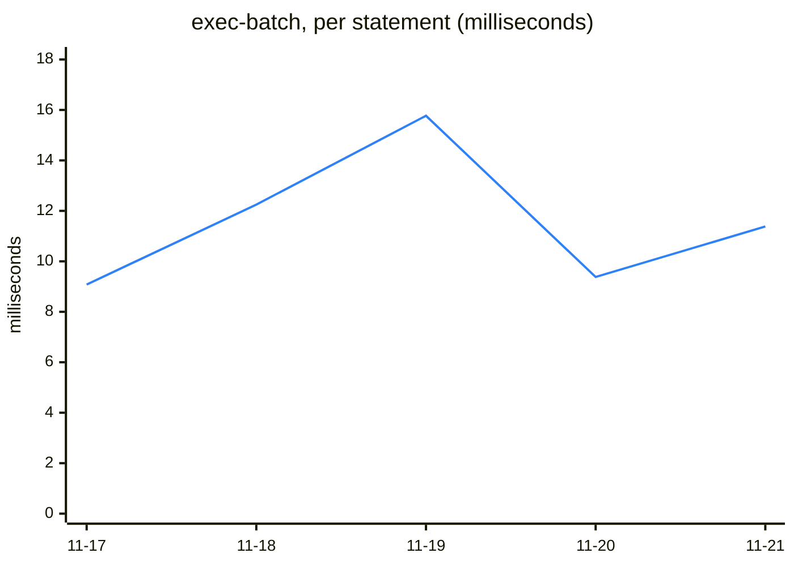
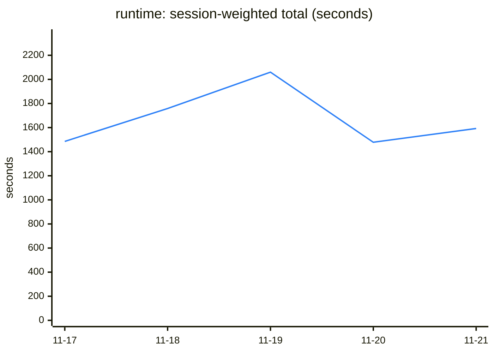

# Agent dev-loop benchmark — trend

5 runs, 2026-11-17 to 2026-11-21. Latest: `mxcli version 4fe3aa9 (2026-11-21T09:08:22Z)` against `mxcli version nightly-20261117-4fe3aa983 (2026-11-17T10:58:18Z)`.

Generated by `scripts/agentbench/trend` after each run; do not edit. Times are the candidate's median wall time on that night's runner, so two nights differ by the machine as well as by the code: read a level that stays, not one night's step. How to read it: `docs-site/src/internals/agent-benchmark.md` on `main`.

## Alerts

None.

## small project — 370 units

| step | latest | run before | median of the 7 before | against that median | against its baseline, latest | last runs |
|---|---:|---:|---:|---:|---:|---|
| (session-weighted total) | 99.5 s | 84.8 s | 94.3 s | × 1.05 | × 0.99 | ▁▄█▁▃ |
| open-cold | 206 ms | 129 ms | 162 ms | × 1.27 | × 1.17 | ▁█▇▁█ |
| open | 56 ms | 45 ms | 51 ms | × 1.10 | × 1.03 | ▁▅█▁▅ |
| domain | 644 ms | 576 ms | 647 ms | × 1.00 | × 1.01 | ▁▄█▁▂ |
| microflows | 499 ms | 391 ms | 465 ms | × 1.07 | × 0.98 | ▁▅█▁▄ |
| pages | 1.57 s | 1.33 s | 1.54 s | × 1.02 | × 0.92 | ▁▆█▁▄ |
| describe | 120 ms | 105 ms | 115 ms | × 1.04 | × 0.98 | ▁▄█▁▃ |
| catalog | 218 ms | 169 ms | 194 ms | × 1.12 | × 1.04 | ▁▄█▁▄ |
| catalog-full | 1.05 s | 922 ms | 1.05 s | × 1.01 | × 1.00 | ▁▄█▁▃ |
| query | 76 ms | 62 ms | 73 ms | × 1.05 | × 1.00 | ▁▅█▁▄ |
| check | 318 ms | 275 ms | 304 ms | × 1.05 | × 1.01 | ▁▄█▁▃ |
| single-edit | 329 ms | 281 ms | 311 ms | × 1.06 | × 0.98 | ▁▄█▁▃ |
| catalog-after-edit | 221 ms | 166 ms | 194 ms | × 1.14 | × 1.02 | ▁▅█▁▅ |
| bulk-alter | 1.14 s | 936 ms | 1.08 s | × 1.06 | × 1.00 | ▁▅█▁▄ |
| re-exec | 559 ms | 491 ms | 551 ms | × 1.02 | × 1.00 | ▁▅█▁▃ |
| rename | 477 ms | 406 ms | 458 ms | × 1.04 | × 1.04 | ▁▄█▁▃ |

## large project — 910 units

| step | latest | run before | median of the 7 before | against that median | against its baseline, latest | last runs |
|---|---:|---:|---:|---:|---:|---|
| (session-weighted total) | 150.8 s | 124.8 s | 139.1 s | × 1.08 | × 1.00 | ▁▄█▁▄ |
| open-cold | 339 ms | 254 ms | 314 ms | × 1.08 | × 0.87 | ▁██▁▆ |
| open | 67 ms | 55 ms | 64 ms | × 1.05 | × 1.00 | ▁▅█▁▄ |
| domain | 769 ms | 671 ms | 759 ms | × 1.01 | × 0.98 | ▁▄█▁▃ |
| microflows | 1.19 s | 884 ms | 1.00 s | × 1.19 | × 1.03 | ▁▃█▁▄ |
| pages | 2.19 s | 1.64 s | 1.85 s | × 1.19 | × 1.04 | ▁▅█▁▆ |
| describe | 145 ms | 124 ms | 137 ms | × 1.05 | × 1.01 | ▁▃█▁▃ |
| catalog | 326 ms | 254 ms | 293 ms | × 1.11 | × 0.99 | ▁▄█▁▄ |
| catalog-full | 3.28 s | 2.88 s | 3.28 s | × 1.00 | × 1.01 | ▁▄█▁▂ |
| query | 81 ms | 63 ms | 74 ms | × 1.09 | × 0.98 | ▁▅█▁▄ |
| check | 502 ms | 428 ms | 470 ms | × 1.07 | × 0.99 | ▁▄█▁▃ |
| single-edit | 504 ms | 411 ms | 459 ms | × 1.10 | × 1.00 | ▁▄█▁▄ |
| catalog-after-edit | 322 ms | 240 ms | 291 ms | × 1.11 | × 0.99 | ▁▆█▁▅ |
| bulk-alter | 1.37 s | 1.15 s | 1.31 s | × 1.05 | × 1.03 | ▁▅█▁▄ |
| re-exec | 776 ms | 666 ms | 741 ms | × 1.05 | × 1.00 | ▁▄█▁▃ |
| rename | 936 ms | 801 ms | 909 ms | × 1.03 | × 0.97 | ▁▄█▁▃ |

## scale project — 4374 units

| step | latest | run before | median of the 7 before | against that median | against its baseline, latest | last runs |
|---|---:|---:|---:|---:|---:|---|
| (session-weighted total) | 5.68 s | 4.66 s | 5.30 s | × 1.07 | × 1.00 | ▁▄█▁▄ |
| check-cold | 1.67 s | 1.28 s | 1.49 s | × 1.12 | × 1.02 | ▁▅█▁▅ |
| check-one | 555 ms | 469 ms | 512 ms | × 1.08 | × 1.00 | ▁▃█▁▃ |
| check-batch | 977 ms | 879 ms | 959 ms | × 1.02 | × 1.01 | ▁▃█▁▃ |
| exec-batch | 1.14 s | 938 ms | 1.08 s | × 1.05 | × 0.98 | ▁▄█▁▃ |
| re-exec-batch | 592 ms | 508 ms | 557 ms | × 1.06 | × 1.00 | ▁▄█▁▃ |
| new-batch | 755 ms | 585 ms | 700 ms | × 1.08 | × 0.98 | ▁▅█▁▄ |

## running app — 476 units

| step | latest | run before | median of the 7 before | against that median | against its baseline, latest | last runs |
|---|---:|---:|---:|---:|---:|---|
| (session-weighted total) | 1592.5 s | 1478.1 s | 1621.8 s | × 0.98 | × 1.01 | ▁▄█▁▂ |
| mx-check | 5.88 s | 5.65 s | 6.22 s | × 0.95 | × 0.99 | ▁▄█▁▂ |
| build | 50.0 s | 42.2 s | 47.7 s | × 1.05 | × 1.02 | ▁▆█▁▅ |
| boot | 23.6 s | 20.8 s | 24.5 s | × 0.96 | × 1.06 | ▂▅█▁▃ |
| page-check | 2.74 s | 2.48 s | 2.87 s | × 0.96 | × 1.00 | ▃▆█▁▃ |
| hot-apply | 4.64 s | 4.34 s | 4.76 s | × 0.98 | × 1.00 | ▁▄█▁▂ |
| test-attach | 110 ms | 92 ms | 103 ms | × 1.08 | × 1.02 | ▁▃█▁▄ |
| apply-entity | 15.8 s | 14.8 s | 15.6 s | × 1.02 | × 1.05 | ▁▄█▁▃ |
| stop | 733 ms | 628 ms | 681 ms | × 1.08 | × 1.00 | ▁▆█▃▆ |
| test-cold | 19.6 s | 18.8 s | 20.4 s | × 0.96 | × 0.98 | ▁▄█▁▁ |
