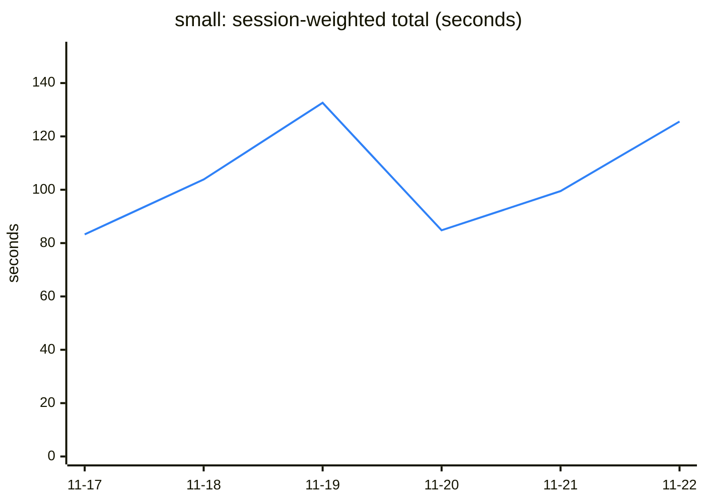
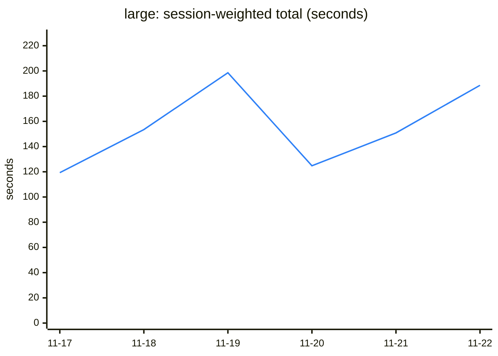
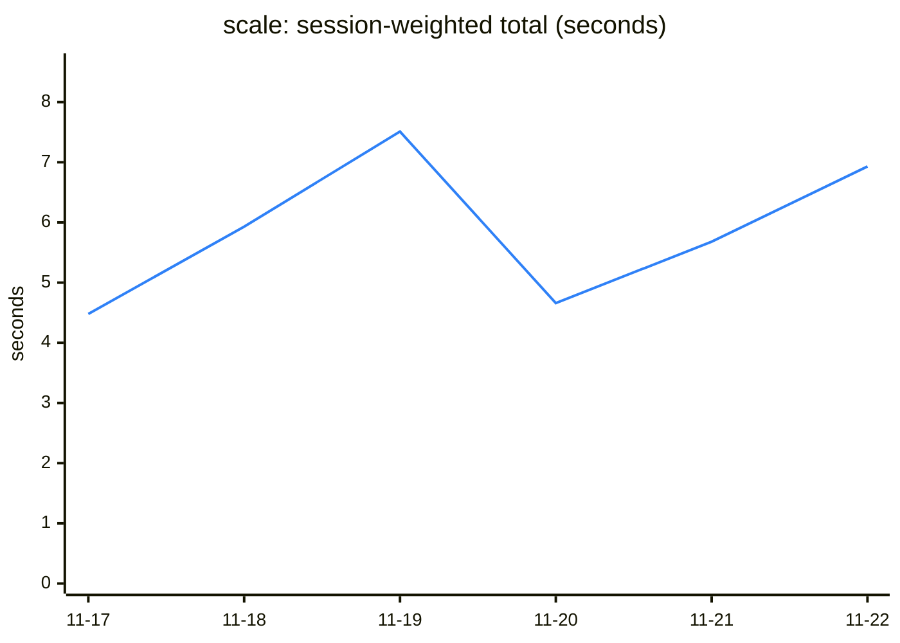
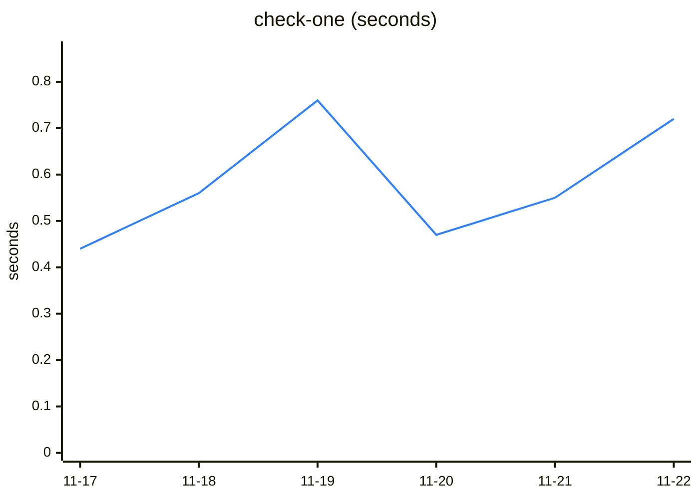
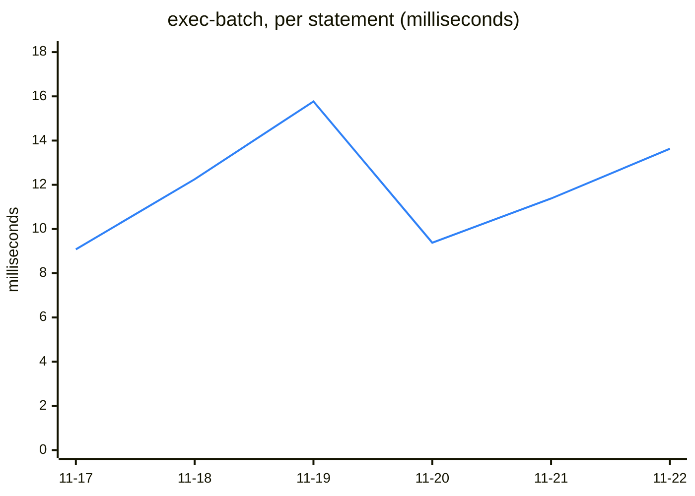
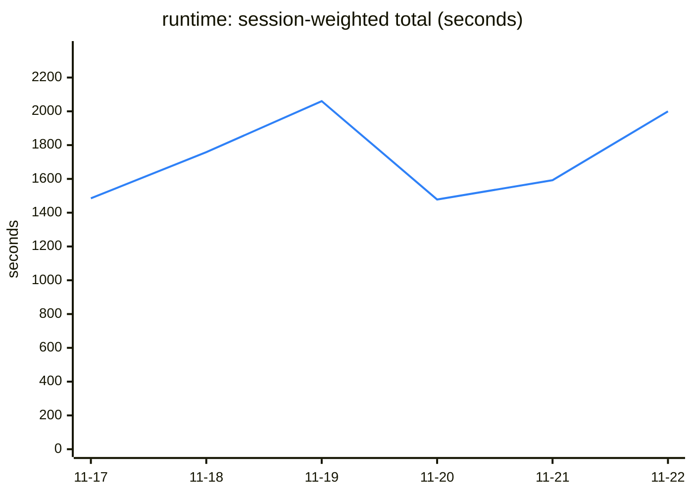

# Agent dev-loop benchmark — trend

6 runs, 2026-11-17 to 2026-11-22. Latest: `mxcli version 4fe3aa9 (2026-11-22T09:16:38Z)` against `mxcli version nightly-20261117-4fe3aa983 (2026-11-17T10:58:18Z)`.

Generated by `scripts/agentbench/trend` after each run; do not edit. Times are the candidate's median wall time on that night's runner, so two nights differ by the machine as well as by the code: read a level that stays, not one night's step. How to read it: `docs-site/src/internals/agent-benchmark.md` on `main`.

## Alerts

None.

## small project — 370 units

| step | latest | run before | median of the 7 before | against that median | against its baseline, latest | last runs |
|---|---:|---:|---:|---:|---:|---|
| (session-weighted total) | 125.6 s | 99.5 s | 99.5 s | × 1.26 | × 1.00 | ▁▄█▁▃▇ |
| open-cold | 190 ms | 206 ms | 192 ms | × 0.99 | × 1.02 | ▁█▇▁█▇ |
| open | 67 ms | 56 ms | 56 ms | × 1.19 | × 0.98 | ▁▅█▁▅█ |
| domain | 837 ms | 644 ms | 644 ms | × 1.30 | × 1.00 | ▁▄█▁▂▇ |
| microflows | 607 ms | 499 ms | 499 ms | × 1.22 | × 1.00 | ▁▅█▁▄█ |
| pages | 1.96 s | 1.57 s | 1.57 s | × 1.25 | × 0.99 | ▁▆█▁▄█ |
| describe | 153 ms | 120 ms | 120 ms | × 1.27 | × 0.98 | ▁▄█▁▃▇ |
| catalog | 279 ms | 218 ms | 218 ms | × 1.28 | × 1.01 | ▁▄█▁▄█ |
| catalog-full | 1.41 s | 1.05 s | 1.05 s | × 1.34 | × 0.99 | ▁▄█▁▃█ |
| query | 97 ms | 76 ms | 76 ms | × 1.27 | × 1.01 | ▁▅█▁▄█ |
| check | 400 ms | 318 ms | 318 ms | × 1.26 | × 1.00 | ▁▄█▁▃▇ |
| single-edit | 418 ms | 329 ms | 329 ms | × 1.27 | × 1.01 | ▁▄█▁▃▇ |
| catalog-after-edit | 265 ms | 221 ms | 221 ms | × 1.20 | × 0.98 | ▁▅█▁▅█ |
| bulk-alter | 1.38 s | 1.14 s | 1.14 s | × 1.21 | × 1.01 | ▁▅█▁▄▇ |
| re-exec | 699 ms | 559 ms | 559 ms | × 1.25 | × 0.99 | ▁▅█▁▃█ |
| rename | 607 ms | 477 ms | 477 ms | × 1.27 | × 1.00 | ▁▄█▁▃█ |

## large project — 910 units

| step | latest | run before | median of the 7 before | against that median | against its baseline, latest | last runs |
|---|---:|---:|---:|---:|---:|---|
| (session-weighted total) | 188.6 s | 150.8 s | 150.8 s | × 1.25 | × 1.00 | ▁▄█▁▄▇ |
| open-cold | 353 ms | 339 ms | 339 ms | × 1.04 | × 1.01 | ▁██▁▆▇ |
| open | 83 ms | 67 ms | 67 ms | × 1.24 | × 0.99 | ▁▅█▁▄▇ |
| domain | 984 ms | 769 ms | 769 ms | × 1.28 | × 0.99 | ▁▄█▁▃▇ |
| microflows | 1.53 s | 1.19 s | 1.12 s | × 1.37 | × 1.00 | ▁▃█▁▄▇ |
| pages | 2.39 s | 2.19 s | 2.06 s | × 1.16 | × 0.99 | ▁▅█▁▆▇ |
| describe | 185 ms | 145 ms | 145 ms | × 1.28 | × 1.01 | ▁▃█▁▃▇ |
| catalog | 426 ms | 326 ms | 326 ms | × 1.31 | × 1.01 | ▁▄█▁▄█ |
| catalog-full | 4.43 s | 3.28 s | 3.28 s | × 1.35 | × 1.00 | ▁▄█▁▂█ |
| query | 105 ms | 81 ms | 81 ms | × 1.30 | × 1.08 | ▁▅█▁▄█ |
| check | 641 ms | 502 ms | 502 ms | × 1.28 | × 1.00 | ▁▄█▁▃█ |
| single-edit | 622 ms | 504 ms | 504 ms | × 1.23 | × 0.99 | ▁▄█▁▄█ |
| catalog-after-edit | 375 ms | 322 ms | 322 ms | × 1.17 | × 1.00 | ▁▆█▁▅▇ |
| bulk-alter | 1.68 s | 1.37 s | 1.37 s | × 1.22 | × 1.00 | ▁▅█▁▄▇ |
| re-exec | 987 ms | 776 ms | 776 ms | × 1.27 | × 1.00 | ▁▄█▁▃▇ |
| rename | 1.24 s | 936 ms | 936 ms | × 1.32 | × 1.00 | ▁▄█▁▃█ |

## scale project — 4374 units

| step | latest | run before | median of the 7 before | against that median | against its baseline, latest | last runs |
|---|---:|---:|---:|---:|---:|---|
| (session-weighted total) | 6.93 s | 5.68 s | 5.68 s | × 1.22 | × 0.99 | ▁▄█▁▄▇ |
| check-cold | 1.90 s | 1.67 s | 1.67 s | × 1.14 | × 0.98 | ▁▅█▁▅▇ |
| check-one | 716 ms | 555 ms | 555 ms | × 1.29 | × 0.99 | ▁▃█▁▃▇ |
| check-batch | 1.28 s | 977 ms | 977 ms | × 1.31 | × 1.00 | ▁▃█▁▃▇ |
| exec-batch | 1.36 s | 1.14 s | 1.14 s | × 1.20 | × 0.99 | ▁▄█▁▃▆ |
| re-exec-batch | 741 ms | 592 ms | 592 ms | × 1.25 | × 1.00 | ▁▄█▁▃▇ |
| new-batch | 931 ms | 755 ms | 755 ms | × 1.23 | × 1.00 | ▁▅█▁▄▇ |

## running app — 476 units

| step | latest | run before | median of the 7 before | against that median | against its baseline, latest | last runs |
|---|---:|---:|---:|---:|---:|---|
| (session-weighted total) | 1999.9 s | 1592.5 s | 1592.5 s | × 1.26 | × 1.00 | ▁▄█▁▂█ |
| mx-check | 8.19 s | 5.88 s | 5.88 s | × 1.39 | × 0.98 | ▁▄█▁▂█ |
| build | 56.9 s | 50.0 s | 50.0 s | × 1.14 | × 1.00 | ▁▆█▁▅█ |
| boot | 30.4 s | 23.6 s | 23.6 s | × 1.29 | × 1.03 | ▂▅█▁▃█ |
| page-check | 3.23 s | 2.74 s | 2.74 s | × 1.18 | × 1.01 | ▃▆█▁▃█ |
| hot-apply | 5.50 s | 4.64 s | 4.64 s | × 1.18 | × 1.00 | ▁▄█▁▂▆ |
| test-attach | 138 ms | 110 ms | 108 ms | × 1.28 | × 1.04 | ▁▃█▁▄█ |
| apply-entity | 18.2 s | 15.8 s | 15.8 s | × 1.15 | × 1.01 | ▁▄█▁▃▇ |
| stop | 842 ms | 733 ms | 733 ms | × 1.15 | × 0.99 | ▁▆█▃▆█ |
| test-cold | 25.0 s | 19.6 s | 19.6 s | × 1.28 | × 0.99 | ▁▄█▁▁█ |
