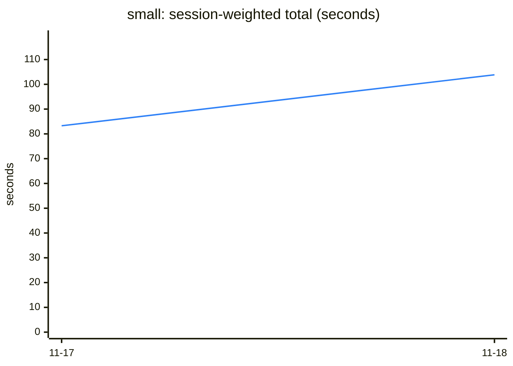
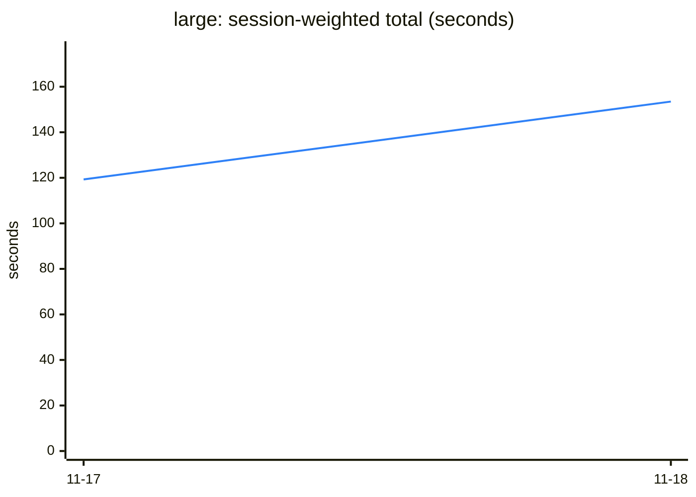
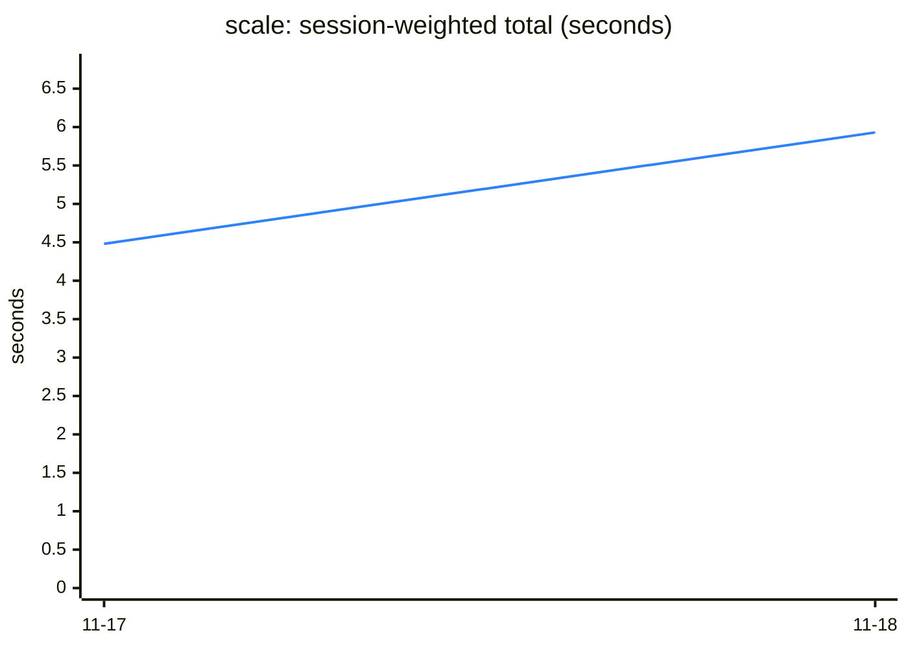
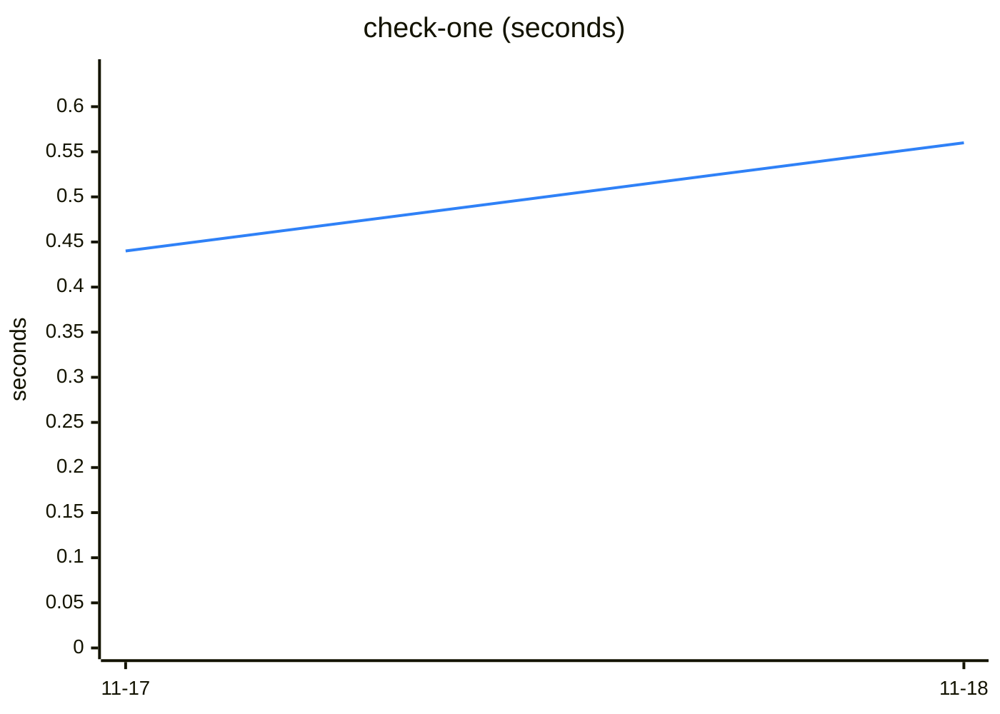
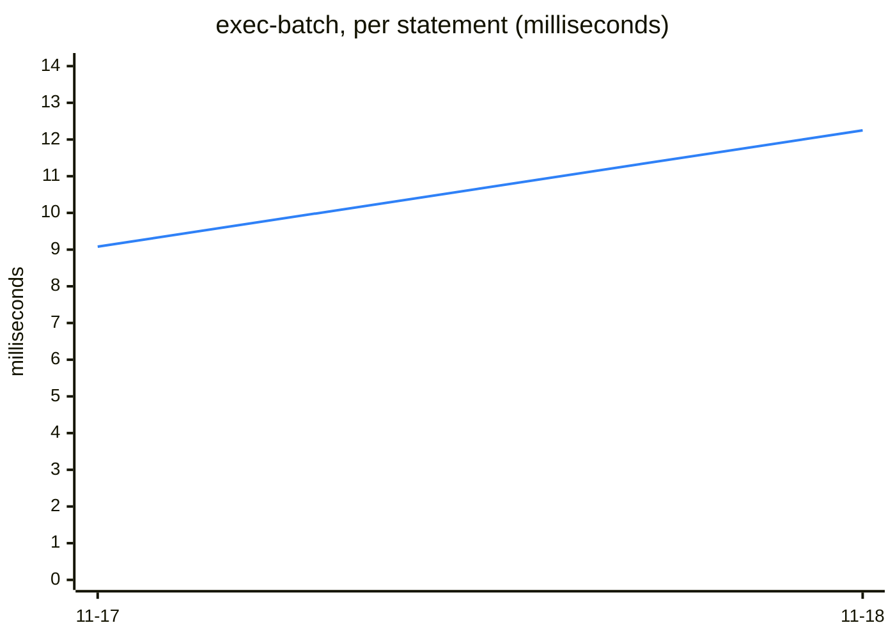
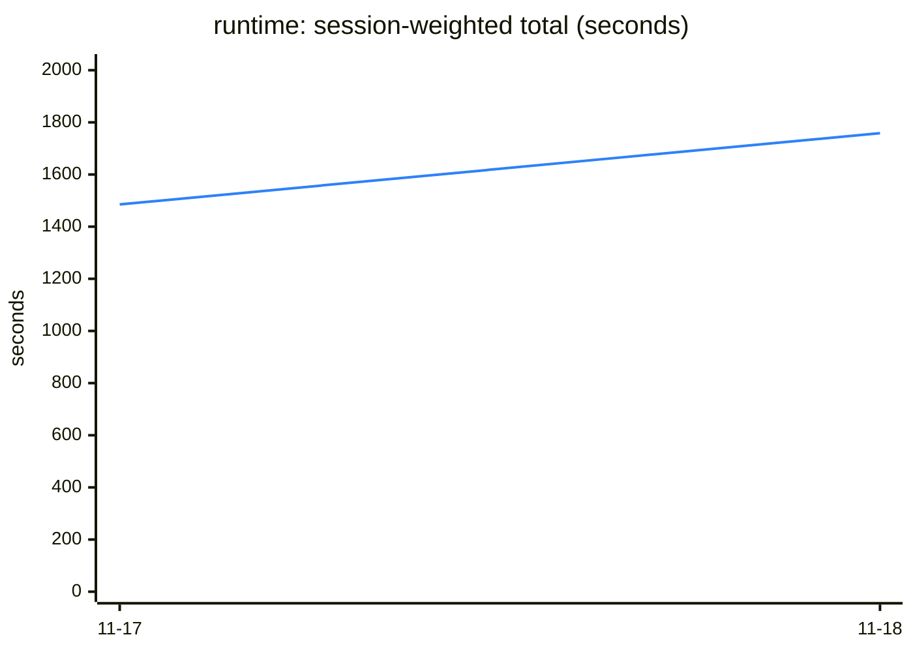

# Agent dev-loop benchmark — trend

2 runs, 2026-11-17 to 2026-11-18. Latest: `mxcli version 4fe3aa9 (2026-11-18T09:40:57Z)` against `mxcli version nightly-20261117-4fe3aa983 (2026-11-17T10:58:18Z)`.

Generated by `scripts/agentbench/trend` after each run; do not edit. Times are the candidate's median wall time on that night's runner, so two nights differ by the machine as well as by the code: read a level that stays, not one night's step. How to read it: `docs-site/src/internals/agent-benchmark.md` on `main`.

## Alerts

None.

## small project — 370 units

| step | latest | run before | median of the 7 before | against that median | against its baseline, latest | last runs |
|---|---:|---:|---:|---:|---:|---|
| (session-weighted total) | 103.8 s | 83.3 s | 83.3 s | × 1.25 | × 0.99 | ▁█ |
| open-cold | 199 ms | 131 ms | 131 ms | × 1.51 | × 1.10 | ▁█ |
| open | 57 ms | 43 ms | 43 ms | × 1.34 | × 1.05 | ▁█ |
| domain | 718 ms | 568 ms | 568 ms | × 1.26 | × 1.00 | ▁█ |
| microflows | 539 ms | 389 ms | 389 ms | × 1.39 | × 1.00 | ▁█ |
| pages | 1.75 s | 1.30 s | 1.30 s | × 1.34 | × 0.99 | ▁█ |
| describe | 126 ms | 101 ms | 101 ms | × 1.25 | × 0.98 | ▁█ |
| catalog | 219 ms | 165 ms | 165 ms | × 1.33 | × 1.01 | ▁█ |
| catalog-full | 1.17 s | 894 ms | 894 ms | × 1.31 | × 1.00 | ▁█ |
| query | 82 ms | 64 ms | 64 ms | × 1.27 | × 1.01 | ▁█ |
| check | 332 ms | 268 ms | 268 ms | × 1.24 | × 1.00 | ▁█ |
| single-edit | 342 ms | 278 ms | 278 ms | × 1.23 | × 1.01 | ▁█ |
| catalog-after-edit | 222 ms | 162 ms | 162 ms | × 1.37 | × 1.00 | ▁█ |
| bulk-alter | 1.22 s | 933 ms | 933 ms | × 1.31 | × 1.00 | ▁█ |
| re-exec | 610 ms | 491 ms | 491 ms | × 1.24 | × 1.00 | ▁█ |
| rename | 509 ms | 392 ms | 392 ms | × 1.30 | × 1.00 | ▁█ |

## large project — 910 units

| step | latest | run before | median of the 7 before | against that median | against its baseline, latest | last runs |
|---|---:|---:|---:|---:|---:|---|
| (session-weighted total) | 153.5 s | 119.3 s | 119.3 s | × 1.29 | × 1.00 | ▁█ |
| open-cold | 379 ms | 247 ms | 247 ms | × 1.53 | × 1.12 | ▁█ |
| open | 72 ms | 52 ms | 52 ms | × 1.40 | × 0.97 | ▁█ |
| domain | 846 ms | 661 ms | 661 ms | × 1.28 | × 1.00 | ▁█ |
| microflows | 1.12 s | 840 ms | 840 ms | × 1.33 | × 1.00 | ▁█ |
| pages | 2.06 s | 1.55 s | 1.55 s | × 1.33 | × 0.99 | ▁█ |
| describe | 150 ms | 119 ms | 119 ms | × 1.26 | × 1.01 | ▁█ |
| catalog | 332 ms | 247 ms | 247 ms | × 1.34 | × 0.98 | ▁█ |
| catalog-full | 3.67 s | 2.85 s | 2.85 s | × 1.29 | × 0.99 | ▁█ |
| query | 86 ms | 61 ms | 61 ms | × 1.41 | × 1.01 | ▁█ |
| check | 512 ms | 404 ms | 404 ms | × 1.27 | × 0.99 | ▁█ |
| single-edit | 506 ms | 395 ms | 395 ms | × 1.28 | × 1.00 | ▁█ |
| catalog-after-edit | 342 ms | 232 ms | 232 ms | × 1.47 | × 1.02 | ▁█ |
| bulk-alter | 1.46 s | 1.11 s | 1.11 s | × 1.31 | × 0.99 | ▁█ |
| re-exec | 816 ms | 648 ms | 648 ms | × 1.26 | × 1.01 | ▁█ |
| rename | 1.02 s | 783 ms | 783 ms | × 1.30 | × 1.00 | ▁█ |

## scale project — 4374 units

| step | latest | run before | median of the 7 before | against that median | against its baseline, latest | last runs |
|---|---:|---:|---:|---:|---:|---|
| (session-weighted total) | 5.93 s | 4.48 s | 4.48 s | × 1.32 | × 1.00 | ▁█ |
| check-cold | 1.69 s | 1.23 s | 1.23 s | × 1.37 | × 1.05 | ▁█ |
| check-one | 555 ms | 443 ms | 443 ms | × 1.25 | × 1.01 | ▁█ |
| check-batch | 1.04 s | 836 ms | 836 ms | × 1.24 | × 1.00 | ▁█ |
| exec-batch | 1.22 s | 908 ms | 908 ms | × 1.35 | × 0.95 | ▁█ |
| re-exec-batch | 607 ms | 494 ms | 494 ms | × 1.23 | × 1.00 | ▁█ |
| new-batch | 816 ms | 569 ms | 569 ms | × 1.43 | × 1.01 | ▁█ |

## running app — 476 units

| step | latest | run before | median of the 7 before | against that median | against its baseline, latest | last runs |
|---|---:|---:|---:|---:|---:|---|
| (session-weighted total) | 1758.3 s | 1485.4 s | 1485.4 s | × 1.18 | × 1.01 | ▁█ |
| mx-check | 6.79 s | 5.46 s | 5.46 s | × 1.24 | × 1.02 | ▁█ |
| build | 53.3 s | 40.8 s | 40.8 s | × 1.31 | × 0.99 | ▁█ |
| boot | 26.1 s | 22.8 s | 22.8 s | × 1.14 | × 1.06 | ▁█ |
| page-check | 3.03 s | 2.71 s | 2.71 s | × 1.12 | × 1.04 | ▁█ |
| hot-apply | 5.17 s | 4.33 s | 4.33 s | × 1.19 | × 1.00 | ▁█ |
| test-attach | 108 ms | 97 ms | 97 ms | × 1.11 | × 0.94 | ▁█ |
| apply-entity | 16.3 s | 14.8 s | 14.8 s | × 1.11 | × 1.02 | ▁█ |
| stop | 734 ms | 528 ms | 528 ms | × 1.39 | × 1.00 | ▁█ |
| test-cold | 21.9 s | 18.8 s | 18.8 s | × 1.17 | × 0.99 | ▁█ |
