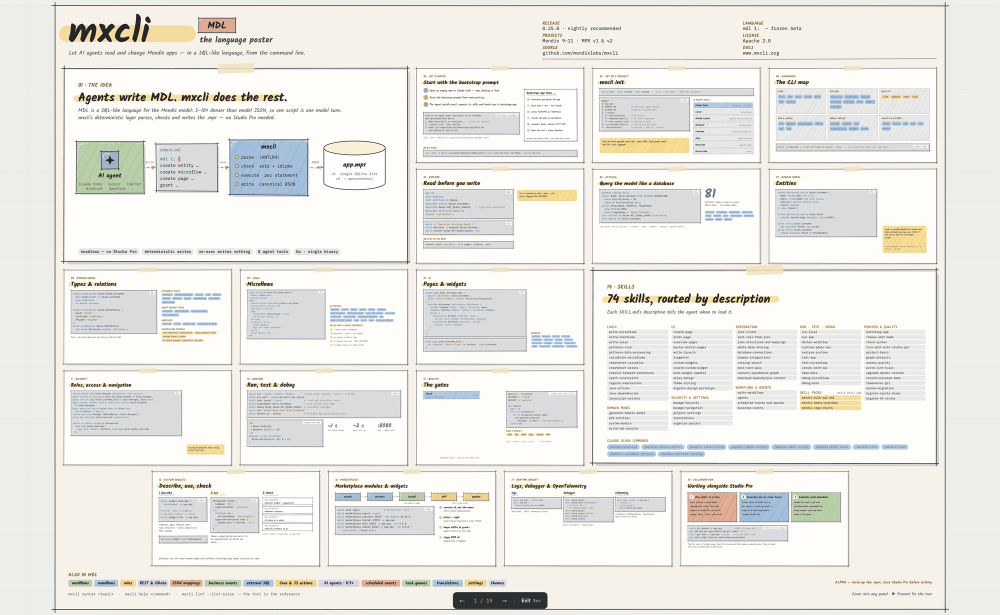

# Release: mxcli v0.26.0

*October 11, 2026*

v0.26.0 makes the documents mxcli writes **mergeable in Studio Pro**. It also adds a **companion Project pane for Claude Code**, makes `describe` → `exec` keep Studio Pro-authored microflows and pages unchanged, and introduces the **mxcli language poster**.

## The language poster

All of mxcli and MDL on one page: the idea, getting started with the bootstrap prompt, the CLI map, exploring and querying a project, domain models, microflows, pages, security, running and testing, the quality gates, skills, custom widgets, the Marketplace, runtime insight, and working alongside Studio Pro.

[](../poster/mxcli-language-poster.html)

**[Open the interactive poster](../poster/mxcli-language-poster.html)**. Zoom into any panel, or step through it as a 19-panel tour.

## What's new

**Documents that survive Studio Pro's merge.** Mendix's merge and diff engine compares an element's property *names* between two revisions and throws when they differ. So when mxcli left out a key, or wrote one the project's Mendix version doesn't have, the document became unmergeable the first time Studio Pro saved it, even though `mx check`, the build and the runtime were all green. Every element mxcli writes now carries exactly the property set Studio Pro writes for that version. The set comes from a table measured with `mx convert` across Mendix 10.24, 11.6 and 11.12–11.15. For a project an older mxcli already wrote to, run:

```bash
mxcli fix property-sets -p app.mpr --dry-run   # see what would change
mxcli fix property-sets -p app.mpr
```

**The mxcli companion.** A Claude Code mod that `mxcli init` installs. `/mxcli-project` opens a Project pane with the app's structure and the selected document's MDL, and it reloads as the agent changes the model.

**Round trips that change nothing.** `describe` → `exec` of Studio Pro-authored microflows now keeps loop back-edges, shared error handlers and dead-end loop branches, which were found on real Marketplace modules. Pages keep their layout grid design properties, alignment and input submit behaviour.

**`check -p` agrees with `exec` more often.** A set of scripts is checked against what the earlier files create. Security statements resolve the roles and documents they name. Several XPath and expression mistakes that only failed at build time are now refused up front.

**New in MDL.** `DateTime not localized`, `close page n`, `add $X to $Obj/Module.Assoc`, module documentation, and `alter app security (AdminUserName: …)`.

**The dev loop.** `mxcli run --local --detach` runs the app as a background service, and `mxcli playwright check` gives a text verdict for a list of pages in one call. `run --local` and `test --local` also work on Windows without Developer Mode, including domain model changes under `--watch`.

## Upgrading

Download the `v0.26.0` binary for your platform from the [release page](https://github.com/mendixlabs/mxcli/releases/tag/v0.26.0):

```bash
curl -fsSL -o mxcli \
  https://github.com/mendixlabs/mxcli/releases/download/v0.26.0/mxcli-linux-amd64
chmod +x mxcli && sudo mv mxcli /usr/local/bin/
```

Then refresh a project's skills, commands and the companion mod with `mxcli init --sync-skills`.

Behaviour changes worth knowing:

- A page or snippet variable's default is now a bare expression (`= true`, not `= 'true'`). The old form still works and warns **MDL-DEPR086**.
- A published OData service's authentication is a property (`Authentication: (basic, session)`), and `call rest service` takes its settings as one property list.

Full changelog: [CHANGELOG.md](https://github.com/mendixlabs/mxcli/blob/main/CHANGELOG.md)
